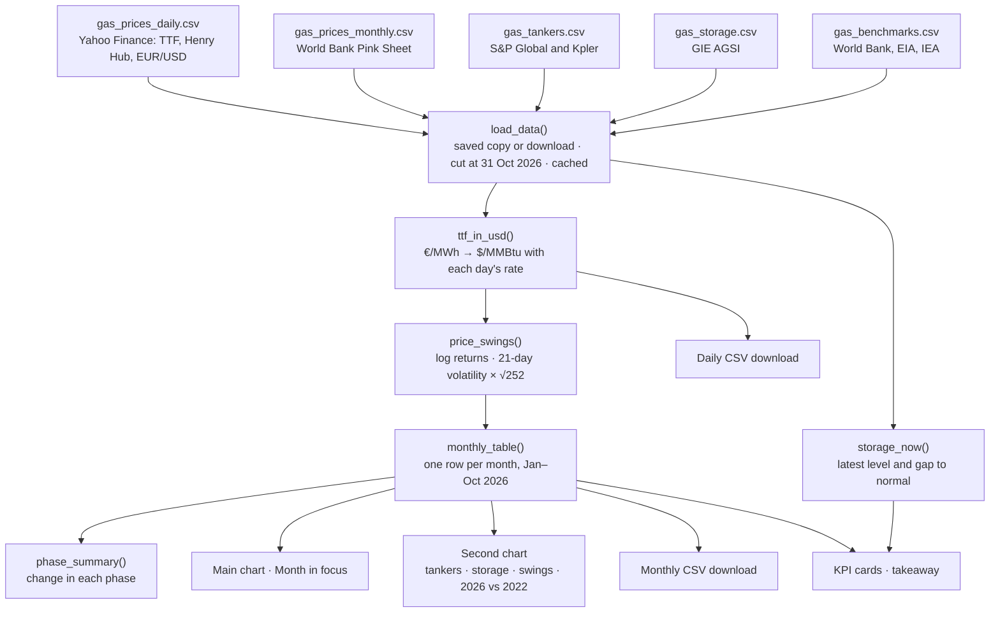

# Gas & LNG: Data Processing and Analysis

**Prepared by:** Eabha Kelly  
**Dashboard:** Hormuz Shock · **Implementation:** `panels/gas_lng.py` · **Tests:** `tests/test_gas.py`  
**Data cut-off:** 31 October 2026  
**Purpose:** Explain how the Gas & LNG panel's raw data is collected, processed, analysed and presented.

---

## Executive summary

The panel combines five datasets to track European and US gas prices, LNG tanker traffic through the Strait of Hormuz, EU gas storage and price volatility. European prices are converted into US dollars per MMBtu, so they can be compared with US and Asian prices. A single monthly table then supplies every card, chart, summary and download.

### Key figures, October 2026

| Indicator | Result |
|---|---:|
| European gas price (TTF) | **\$28.50/MMBtu** |
| Change since February 2026 | **+153.6%** |
| Europe / US price ratio | **9.5×** |
| LNG tankers through Hormuz | **31**, or 36.5% of February |
| EU gas storage (27 October) | **75.0% full** |
| Gap to the five-year average | **−13.1 percentage points** |
| Volatility before / since the war | **53% / 79% a year** |

**Interpretation:** By October, European gas cost more than two and a half times its pre-war level. It was also 9.5 times the US price. Tanker traffic remained about a third of normal, and EU storage entered winter well below its usual level. These indicators describe what happened. On their own, they do not prove causation.

---

## 1. Overview

The panel investigates three related questions:

1. **How far has the Hormuz shock raised European gas prices, and how does Europe compare with the US and Asia?**
2. **How much LNG is still passing through the Strait of Hormuz?**
3. **Is Europe prepared for winter, and how unstable has the market become?**

### How the panel works

| Stage | What happens | Main functions |
|---|---|---|
| 1. Collect | Read five saved CSV files, or download fresh daily prices from Yahoo Finance | `load_data()`, `download_daily()` |
| 2. Process | Parse dates, apply the cut-off, convert units and currency, build the monthly table | `ttf_in_usd()`, `monthly_table()`, `phase_for()` |
| 3. Analyse | Calculate price changes, the Europe/US ratio, tanker and storage measures, volatility and phase summaries | `price_swings()`, `swings_summary()`, `storage_now()`, `phase_summary()` |
| 4. Present | Show the KPI cards, two linked charts, the Month in focus card, the takeaway and downloads | `render()`, `main_figure()`, `second_figure()` |



Tests are in `tests/test_gas.py`.

---

## 2. Data sources

| Variable | Source | Coverage | Local file |
|---|---|---|---|
| Daily European gas price (TTF, €/MWh), US gas price (Henry Hub, \$/MMBtu) and EUR/USD | Yahoo Finance via `yfinance`: `TTF=F`, `NG=F`, `EURUSD=X` | 281 trading days, 1 Oct 2025 – 30 Oct 2026 | `data/gas_prices_daily.csv` |
| Monthly European gas price (\$/MMBtu) | World Bank Pink Sheet (Natural gas, Europe = Dutch TTF) | Jan – Oct 2026 | `data/gas_prices_monthly.csv` |
| LNG tankers through Hormuz | S&P Global Commodity Insights and Kpler, as reported in the news | Feb – Oct 2026 | `data/gas_tankers.csv` |
| EU gas storage (% full) | GIE AGSI, as reported by Argus, GMK Center, S&P Global, TASS and others | 18 readings, Apr – Oct 2026 | `data/gas_storage.csv` |
| Asian LNG price (JKM) and benchmarks | World Bank, EIA and IEA; the 2022 peak is rounded | 4 points in time | `data/gas_benchmarks.csv` |

The tanker, storage and benchmark files were compiled by hand from the reports linked on each row. Every row has a `source` or `url` column, so each number can be traced back. All data is cut at **31 October 2026**, like the other panels.

**Units**
- **€/MWh:** euros per megawatt-hour, the unit European gas (TTF) trades in.
- **\$/MMBtu:** US dollars per million British thermal units, the unit for US gas (Henry Hub) and Asian LNG (JKM).
- **% full:** EU gas storage as a share of total capacity.

### Storage data notes

`gas_storage.csv` holds three series in long format: `2026`, `2025 (same date)` and `5-year average`. Three five-year-average values are derived from the 2026 level plus a reported gap:

$$
\text{5-year average}_d = \text{2026 level}_d + \text{reported gap}_d
$$

For example, on 6 October 2026: $73.0 + 15.11 = 88.1\%$. One 2025 value (1 April) was derived from the reported volume in storage divided by EU capacity. The `how` column records whether each value was reported or derived.

---

## 3. Collecting and processing the data

### 3.1 Loading and the common cut-off

**Function:** `load_data(live)`

1. **Find the data folder.** `data_folder()` locates `data/` relative to the project, so the panel runs from any working directory.
2. **Read each CSV** into a pandas DataFrame and convert the date columns with `pd.to_datetime`.
3. **Apply the cut-off.** Every series keeps only rows dated on or before 31 October 2026:

$$
\text{keep row } i \iff \text{date}_i \le \text{31 Oct 2026}
$$

This also removes storage readings from November, so all four panels end on the same day.

4. **Cache the result.** `@st.cache_data(ttl="1h")` stores the loaded data for an hour, so clicking a control does not re-read the files.

### 3.2 Using saved data or downloading live data

| Setting | Processing approach |
|---|---|
| Page switch **off** (default) | Read the saved CSV files in `data/`. The panel runs offline and gives the same results every time. |
| Page switch **on** | `download_daily()` requests fresh closes for `TTF=F`, `NG=F` and `EURUSD=X` from 1 October 2025. If Yahoo Finance cannot be reached, the saved copy is used and the page says so. |
| `LIVE = True` in the code | The fresh download also overwrites `data/gas_prices_daily.csv`. The page switch alone never changes the repository's data. |

The live download is cleaned in two steps. First, missing values are **forward-filled**: a ticker with no trade on a given day takes the previous close, so $x_t = x_{t-1}$. Then any row still missing a value is **dropped**, so only days with all three series are used.

### 3.3 Converting European prices into dollars per MMBtu

**Function:** `ttf_in_usd(daily)`

European and US prices use different currencies and different energy units. Each daily TTF price is converted using **that day's** exchange rate:

$$
P^{\text{USD/MMBtu}}_t = P^{\text{EUR/MWh}}_t \times \text{EURUSD}_t \times 0.293071
$$

Multiplying €/MWh by dollars per euro gives \$/MWh. One MMBtu equals 0.293071 MWh, so multiplying by 0.293071 gives \$/MMBtu:

$$
\frac{\text{USD}}{\text{MMBtu}} = \frac{\text{USD}}{\text{MWh}} \times \frac{0.293071\ \text{MWh}}{1\ \text{MMBtu}}
$$

**Worked example, 30 October 2026:**

$$
103.944 \times 1.11828 \times 0.293071 = 34.07\ \text{USD/MMBtu}
$$

Using each day's rate, rather than one average rate, stops currency movements from distorting the comparison.

### 3.4 Building the monthly table

**Function:** `monthly_table(data)`

Every number on the page comes from one table with **one row per month**, January to October 2026. Each dataset is aggregated or looked up to the same `YYYY-MM` key and attached with `.map()`.

| Column | How it is built |
|---|---|
| `month`, `ttf` | World Bank monthly TTF average, \$/MMBtu |
| `date` | The 15th of the month, used for plotting and phase assignment |
| `vs_prev` | Month-on-month % change (section 4.1) |
| `vs_prewar` | % change since February 2026 (section 4.1) |
| `hh` | Monthly mean of daily Henry Hub prices |
| `ratio` | `ttf / hh` (section 4.2) |
| `tankers`, `tracker`, `tanker_note` | Looked up from `gas_tankers.csv` |
| `tanker_pct` | Tankers as % of February (section 4.3) |
| `storage` | Latest 2026 storage reading on or before the month's end (section 4.4) |
| `vol` | Monthly mean of daily annualised volatility (section 4.5) |
| `phase` | The phase containing the mid-month date (section 3.5) |

A month with no matching value is left as `NaN` (January has no tanker count, for example). The panel shows these as "n/a".

Daily series are averaged over the trading days $D_m$ in each month:

$$
\bar{x}_m = \frac{1}{|D_m|}\sum_{t \in D_m} x_t
$$

For October 2026, the mean Henry Hub price was **\$3.00/MMBtu** across 22 trading days.

The monthly European price uses the World Bank's published average, not the mean of the daily Yahoo series. This keeps the headline figures in line with an official, independent source. The daily series is used for the daily price line, the US comparison and volatility.

### 3.5 Assigning each month to a phase of the crisis

**Function:** `phase_for(date)`

The four phases are stored once in the `EVENTS` dictionary and shared across the dashboard:

| Phase | Start | End | Colour |
|---|---|---|---|
| Build-up | 1 Jan 2026 | 28 Feb 2026 | yellow |
| War & closure | 28 Feb 2026 | 8 Apr 2026 | red |
| Ceasefire | 8 Apr 2026 | 8 Jul 2026 | blue |
| Conflict resumes | 8 Jul 2026 | 31 Oct 2026 | purple |

The function returns the first phase whose dates contain the given date:

$$
\text{phase}(d) = \text{first } p \text{ such that } \text{start}_p \le d \le \text{end}_p
$$

Dates outside every phase return `None`. Each month is assigned by its 15th day. So February is Build-up, March is War & closure, April–June are Ceasefire and July–October are Conflict resumes.

---

## 4. Implementing the analysis

### 4.1 Price changes

All price changes are simple percentage changes.

**Month-on-month** (`pct_change()`):

$$
\Delta^{\text{MoM}}_m = \left(\frac{P_m}{P_{m-1}} - 1\right) \times 100
$$

**Since before the war.** February 2026 is the last full month before the strikes on 28 February, so it is the reference:

$$
\Delta^{\text{pre-war}}_m = \left(\frac{P_m}{P_{\text{Feb 2026}}} - 1\right) \times 100
$$

| Month | TTF (\$/MMBtu) | Month-on-month | Since February |
|---|---:|---:|---:|
| February | 11.24 | −4.4% | 0.0% |
| March | 17.91 | +59.3% | +59.3% |
| October | 28.50 | +12.1% | +153.6% |

The KPI card rounds October's change to **+154%**.

### 4.2 The Europe / US price ratio

Both prices are in \$/MMBtu, so the ratio shows how many times more Europe pays:

$$
R_m = \frac{P^{\text{TTF}}_m}{\bar{h}_m}
$$

In October, $28.50 / 3.00 = 9.5$. In February, it was $11.24 / 3.13 = 3.6$. The gap has widened because US gas does not pass through the Strait of Hormuz.

### 4.3 LNG tanker traffic against normal

February 2026 is the reference month, with about **85 laden LNG tankers** leaving the Gulf (S&P Global):

$$
\text{Tankers \% of normal}_m = \frac{N_m}{N_{\text{Feb 2026}}} \times 100 = \frac{N_m}{85} \times 100
$$

**100 = the pre-war level.**

| Month | Tankers | % of normal | Tracker |
|---|---:|---:|---|
| March | 0 | 0.0% | Kpler |
| June | 40 | 47.1% | Kpler |
| October | 31 | 36.5% | S&P Global |

The home-page card shows October as $36.5 - 100 = -63.5\%$, rounded to **−64% vs pre-war**.

### 4.4 EU gas storage and the gap to normal

Storage readings arrive on the days they were reported, not on fixed dates. Two rules handle this.

**Monthly value.** Each month takes the latest 2026 reading on or before its last day:

$$
S_m = S_{d^*}, \qquad d^* = \max\{\, d : d \le \text{end of month } m \,\}
$$

October therefore uses the 27 October reading of **75.0%**.

**Gap to normal** (`storage_now()`). The latest 2026 reading is compared with the most recent five-year average on or before that date:

$$
\text{Gap} = S^{2026}_{d_{\text{last}}} - A_{d'}, \qquad d' = \max\{\, d \le d_{\text{last}} : A_d \text{ exists} \,\}
$$

$$
75.0 - 88.1 = -13.1 \text{ percentage points}
$$

The KPI shows **−13 pts vs normal**. Storage is already a percentage, so the gap is in percentage points, not per cent. The storage chart also draws the EU's **90%** target and **80%** flexible target.

### 4.5 Volatility (price swings)

**Functions:** `price_swings(daily)` and `swings_summary(swings)`

Volatility measures how much the price moves from day to day. It uses the daily European price in \$/MMBtu from section 3.3.

**Stage 1: daily log returns**

$$
r_t = 100 \times \ln\left(\frac{P_t}{P_{t-1}}\right)
$$

```python
ret = np.log(usd).diff() * 100
```

Log returns add up over time, and a rise followed by an equal fall cancels out. For small moves they are very close to simple percentage changes. The first day has no return.

**Stage 2: rolling standard deviation over 21 trading days** (about one month)

$$
\bar{r}_t = \frac{1}{n}\sum_{i=0}^{n-1} r_{t-i}, \qquad
s_t = \sqrt{\frac{1}{n-1}\sum_{i=0}^{n-1}\left(r_{t-i} - \bar{r}_t\right)^2}, \qquad n = 21
$$

```python
vol = ret.rolling(21).std() * np.sqrt(252)
```

Pandas uses the sample standard deviation, with $n - 1$ in the denominator.

**Stage 3: scaling to a yearly figure**

$$
\sigma^{\text{annual}}_t = s_t \times \sqrt{252}
$$

252 is the usual number of trading days in a year. If daily returns are independent, variances add over time, so standard deviations scale with the square root of time (Hull, 2022). The result is in per cent per year.

**Before vs since the war.** `swings_summary()` splits all returns at 28 February 2026. It calculates one annualised figure for each period, using every return rather than a rolling window:

$$
\sigma_{\text{before}} = \text{sd}\{\, r_t : t < \text{28 Feb} \,\} \times \sqrt{252}, \qquad
\sigma_{\text{since}} = \text{sd}\{\, r_t : t \ge \text{28 Feb} \,\} \times \sqrt{252}
$$

The three biggest one-day rises are found with `nlargest(3, "ret")` and marked in red on the Price swings chart. For the monthly table, each month's volatility is the mean of its daily values.

### 4.6 Phase summaries

**Function:** `phase_summary(table, data, phase)`

When the user picks a phase, three measures are calculated:

- **Price change:** from the last monthly price before the phase to the phase's last month.

$$
\Delta_{\text{phase}} = \left(\frac{P_{\text{last month in phase}}}{P_{\text{last month before phase}}} - 1\right) \times 100
$$

- **Average tanker traffic:** the mean count and mean % of normal over the phase's months.
- **Storage change:** the first and last 2026 readings inside the phase dates, shown when there are at least two.

Build-up has no month before it, so its comparison starts from January.

### 4.7 Europe vs Asia: 2026 and 2022

The "2026 vs 2022" chart compares European (TTF) and Asian (JKM) prices at four points: before the war, March 2026, October 2026 and the rounded 2022 crisis peak.

- October TTF was $\left(\frac{28.50}{11.24} - 1\right) \times 100 = +154\%$ above its pre-war level.
- Against the 2022 peak, $28.50 / 90 \approx 0.32$, so about a third.

When the two prices are within 3% of the axis range, one shared label replaces two overlapping ones:

$$
\left|P^{\text{TTF}} - P^{\text{JKM}}\right| < 0.03 \times \left(\max P - \min(P, 0)\right)
$$

In October, $|28.50 - 28.59| = 0.09 < 2.7$, so the label reads "both ≈ \$28.5".

### 4.8 The "% vs pre-war" view

When selected, each price series is rebased to its own February 2026 level:

$$
y_t = \left(\frac{x_t}{x_{\text{Feb 2026}}} - 1\right) \times 100
$$

- European gas (monthly and daily) is rebased to \$11.24, and US gas to its own February average of \$3.13. Both lines start at 0%, so their changes can be compared directly.
- Tankers switch to % of normal, with a reference line at 100%.
- In "2026 vs 2022", TTF is rebased to \$11.24 and JKM to \$10.82.
- Storage and volatility are already percentages, so they do not change.

---

## 5. Main results and interpretation

### 5.1 Full monthly results

These are the values in the monthly table, as shown in the panel and in `gas_lng_monthly.csv`.

| Month | Phase | TTF \$/MMBtu | MoM % | vs Feb % | Henry Hub \$/MMBtu | Europe ÷ US | Tankers | % normal | Tracker | Storage % | Volatility % a year |
|---|---|---:|---:|---:|---:|---:|---:|---:|---|---:|---:|
| Jan 2026 | Build-up | 11.76 | — | +4.6 | 4.21 | 2.8 | — | — | — | — | 52.9 |
| Feb 2026 | Build-up | 11.24 | −4.4 | 0.0 | 3.13 | 3.6 | 85 | 100.0 | S&P Global | — | 85.6 |
| Mar 2026 | War & closure | 17.91 | +59.3 | +59.3 | 3.04 | 5.9 | 0 | 0.0 | Kpler | — | 155.8 |
| Apr 2026 | Ceasefire | 15.41 | −14.0 | +37.1 | 2.68 | 5.7 | 4 | 4.7 | Kpler | 27.7 | 92.6 |
| May 2026 | Ceasefire | 16.17 | +4.9 | +43.9 | 2.94 | 5.5 | 8 | 9.4 | Kpler | 27.7 | 63.5 |
| Jun 2026 | Ceasefire | 15.17 | −6.2 | +35.0 | 3.20 | 4.7 | 40 | 47.1 | Kpler | 42.8 | 50.5 |
| Jul 2026 | Conflict resumes | 18.06 | +19.1 | +60.7 | 2.95 | 6.1 | 18 | 21.2 | S&P Global | 55.4 | 48.8 |
| Aug 2026 | Conflict resumes | 21.11 | +16.9 | +87.8 | 2.77 | 7.6 | 3 | 3.5 | S&P Global | 63.3 | 63.8 |
| Sep 2026 | Conflict resumes | 25.42 | +20.4 | +126.2 | 2.95 | 8.6 | 23 | 27.1 | S&P Global | 71.5 | 50.8 |
| Oct 2026 | Conflict resumes | 28.50 | +12.1 | +153.6 | 3.00 | 9.5 | 31 | 36.5 | S&P Global | 75.0 | 49.2 |

### 5.2 Results by phase

| Phase | European gas price | Average tankers | EU storage |
|---|---:|---:|---|
| Build-up | −4% (\$11.76 → \$11.24) | 85 a month (100% of normal) | — |
| War & closure | +59% (\$11.24 → \$17.91) | 0 a month (0% of normal) | — |
| Ceasefire | −15% (\$17.91 → \$15.17) | 17 a month (20% of normal) | — |
| Conflict resumes | +88% (\$15.17 → \$28.50) | 19 a month (22% of normal) | 55% → 75% full |

### 5.3 Volatility

| Measure | Result |
|---|---:|
| Before the war | **53%** a year |
| Since the war | **79%** a year |
| Peak 21-day volatility | **162%** a year, 27 March 2026 |
| Biggest one-day rises | **+32.8%** (2 Mar), **+19.3%** (3 Mar), **+11.7%** (19 Mar) |

### 5.4 What the results suggest

- **Prices followed the conflict, not the ceasefire.** Prices jumped 59% when the strait closed and eased by 15% during the ceasefire. They then rose by 88% once fighting resumed.
- **The shock hit Europe far harder than the US.** The price gap grew from 3.6 times to 9.5 times. US gas is produced at home and does not depend on Hormuz.
- **LNG traffic never recovered.** Even the best month since the war (June, 40 tankers) was under half of normal.
- **The market became much less stable.** Volatility rose by about half after the war. It peaked at three times its pre-war level in late March.
- **Europe enters winter exposed.** Storage refilled from 28% to 75%, but it remains 13 points below the five-year average. A cold winter could push prices higher.
- **Context:** prices are still about a third of the 2022 peak. The 2026 shock is severe, but smaller than the 2022 crisis in absolute terms.

---

## 6. Worked example: October 2026 from raw data to the page

| Step | Calculation | Result |
|---|---|---:|
| Convert the last daily price | $103.944 \times 1.11828 \times 0.293071$ | \$34.07/MMBtu |
| Monthly European price | World Bank October average | \$28.50 |
| Change since before the war | $(28.50 / 11.24 - 1) \times 100$ | **+153.6%** |
| Monthly US price | Mean of 22 daily Henry Hub closes | \$3.00 |
| Europe / US ratio | $28.50 / 3.00$ | **9.5×** |
| Tankers vs normal | $31 / 85 \times 100$ | **36.5%** |
| Storage gap | $75.0 - 88.1$ | **−13.1 pts** |
| Takeaway | Combines the three results above | "up 154% … 36% of normal … 13 points below normal" |

The daily price (\$34.07) is above the monthly average (\$28.50) because prices rose through October. The KPI uses the monthly average, so it is less affected by any single day.

---

## 7. Presenting the results

### 7.1 Where each number appears

| Dashboard element | Data shown | Section |
|---|---|---|
| KPI: European gas (TTF) | \$28.50, +154% since before the war | 4.1 |
| KPI: Europe pays vs the US | 9.5× | 4.2 |
| KPI: LNG tankers via Hormuz | 31, 36% of normal | 4.3 |
| KPI: EU gas storage | 75.0%, −13 pts vs normal | 4.4 |
| Month in focus | Price, changes, ratio, volatility, plus donuts for tankers and storage | 3.4 |
| Phase summary | Price change, average tankers, storage change | 4.6 |
| Home-page card | \$28.50 (+154%), 31 tankers (−64% vs pre-war) | 4.1, 4.3 |
| Takeaway | +154%, 36% of normal, 13 points below normal | 6 |

Every value is calculated from the data, not typed in. If the data changes, the cards, summaries and takeaway update automatically.

### 7.2 How the interactive controls affect the analysis

| Control | Effect on the panel |
|---|---|
| **Highlight a phase of the crisis** | Shades the phase on both charts, shows its summary line, and moves the Month in focus to the phase's first month. |
| **Price view** | *\$ per MMBtu* or *% vs pre-war* (section 4.8). Changes both charts. |
| **Compare with US gas (Henry Hub)** | Adds the US price to the main chart. |
| **Click a month on either chart** | Selects that month. The second chart and the Month in focus card follow it. |
| **Second chart** | *LNG tankers*, *EU storage*, *Price swings* or *2026 vs 2022*. |
| **◀ Previous / Next ▶** | Steps the Month in focus one month at a time. |
| **Gas data and download** | Opens the monthly and daily tables with CSV downloads. |
| **Download the latest prices from Yahoo Finance** | Switches from the saved copy to a live download (section 3.2). |

All controls share one selected month, stored in `st.session_state["gas_sel"]`, so every chart and card always shows the same month. Changing a control only reruns the calculations, so the panel updates straight away.

### 7.3 Chart rules that depend on the data

- **Labels on dips** (`label_positions()`). A label goes below a point that is lower than both neighbours, so the line climbing out of the dip does not cross it:

$$
\text{position}_i = \begin{cases} \text{below} & \text{if } y_i < y_{i-1} \text{ and } y_i < y_{i+1} \\ \text{above} & \text{otherwise} \end{cases}
$$

The first and last points are compared with $+\infty$ on their missing side. In the 2026 data, February, April and June go below.

- **Phase shading** (`shade_months()`). Monthly charts shade whole months, so the shading lines up with the bars and points. Ceasefire runs from 1 April to 1 July. The daily storage chart uses the exact phase dates.

### 7.4 Downloadable tables

| File | Contents | Rows |
|---|---|---:|
| `gas_lng_monthly.csv` | Month, phase, European and US prices, change since February, ratio, tankers and % of normal, tracker, storage, volatility | 10 |
| `gas_lng_daily.csv` | Date, TTF in €/MWh and \$/MMBtu, Henry Hub, EUR/USD; newest first | 281 |

Monthly values are rounded to 2 decimal places and daily values to 3. The files keep short machine-readable column names; the tables on screen use readable ones.

---

## 8. Testing and validation

`tests/test_gas.py` has **23 tests** (19 test functions, one of which runs for five dates). They use the saved data, so they need no internet. Run them with:

```bash
python3 -m pytest -q tests/test_gas.py
```

### Data-processing tests

| Test | What it checks |
|---|---|
| `test_euro_per_mwh_to_dollars_per_mmbtu` | The conversion gives €10/MWh × 1.1 × 0.293071 in \$/MMBtu. |
| `test_each_date_falls_in_the_right_phase` | Five dates, including one before the build-up, return the correct phase. |
| `test_benchmark_rows_map_to_months` | The benchmark rows are matched to the right months. |
| `test_no_data_after_the_cut_off` | No daily or monthly price is dated after 31 October 2026. |
| `test_one_row_per_month_and_every_month_has_a_phase` | The monthly table has one row per month, each with a phase. |
| `test_february_is_the_pre_war_reference` | February is 0% vs pre-war and 100% of normal tanker traffic. |
| `test_storage_is_a_percentage` | The latest storage reading lies between 0% and 100% and is below the five-year average. |

### Analysis tests

| Test | What it checks |
|---|---|
| `test_change_since_the_war_matches_the_prices` | The change since February matches the formula in section 4.1. |
| `test_europe_pays_more_than_the_us_every_month` | The Europe/US ratio is above 1 in every month. |
| `test_a_steady_price_has_no_volatility` | A constant price gives zero volatility. |
| `test_daily_change_is_a_log_return_in_percent` | Each return equals $100 \ln(P_t / P_{t-1})$. |
| `test_volatility_is_scaled_to_a_year` | The rolling value equals the standard deviation × √252 on simulated data. |
| `test_the_war_made_the_market_jumpier` | Volatility since the war is higher than before. |
| `test_every_month_has_a_volatility` | Every month has a volatility value. |

### Presentation tests

| Test | What it checks |
|---|---|
| `test_phase_shading_covers_whole_months` | Ceasefire shading runs from 1 April to 1 July. |
| `test_no_shading_when_no_phase_is_picked` | No shading is drawn when no phase is selected. |
| `test_labels_go_under_the_dips` | Labels go below local dips. |
| `test_download_has_clear_column_names_and_one_row_per_month` | The monthly download has clear names and 10 rows. |
| `test_daily_table_is_newest_first_and_converts_to_dollars` | The daily download is newest first and its \$/MMBtu column matches the conversion. |

A fresh install of the whole project from a downloaded ZIP was also tested. The requirements installed without errors and all **38 project tests** passed.

---

## 9. Methodological choices

| Choice | Reason |
|---|---|
| Use the World Bank monthly price for the headline | It is an official, published average, so the main figures can be checked independently. |
| Convert with each day's exchange rate | A single average rate would let currency movements distort the comparison. |
| Compare in \$/MMBtu | It is the unit used for US and Asian gas, so all three markets can be compared directly. |
| Use February 2026 as the pre-war reference | It is the last full month before the strikes on 28 February and exists in every series. |
| Use log returns for volatility | They add up over time and treat rises and falls symmetrically. |
| Use a 21-day window | About one month of trading: long enough to be stable, short enough to show the March spike. |
| Annualise with √252 | The standard convention, so the figures compare with published volatility measures (Hull, 2022). |
| Carry storage forward to month-end | Readings are irregular, and this never uses a value from the future. |
| Report the storage gap in percentage points | Storage is already a percentage, so a percentage change would be misleading. |
| Assign months by their 15th day | Each month falls clearly into one phase, even when a phase starts mid-month. |
| Show both tanker trackers, labelled | No single tracker covers every month. Showing the source on hover keeps the switch visible. |
| Include the 2022 peak, rounded | It gives scale without claiming false precision. |
| Use saved data by default | It makes the panel reproducible and usable offline, with a live download as an option. |
| Share the 31 October cut-off | All four panels end on the same day, so their results can be read together. |

---

## 10. Limitations and interpretation

1. **Two tanker trackers.** S&P Global counts laden LNG tankers leaving the Gulf; Kpler counts all LNG-carrier crossings. February and July–October use S&P Global, and March–June use Kpler. Changes across the switch are approximate.
2. **A single reference month.** February 2026 is one month. A longer pre-war average would be more robust.
3. **Irregular storage readings.** A month with no new reading repeats the previous one: April and May both show 27.7%.
4. **Derived five-year averages.** Three values come from the 2026 level plus a reported gap. The latest gap compares 27 October with the 6 October average, which changes little over a few weeks.
5. **Futures, not spot prices.** Daily TTF and Henry Hub prices are front-month futures closes, and missing days are forward-filled.
6. **Annualised volatility is an approximation.** The √252 rule assumes independent daily returns, but energy prices often have clustered volatility.
7. **The 2022 peak is rounded** and is used only for scale.
8. **Association is not causation.** The panel describes what happened. Prices also respond to weather, demand and other supply routes, not only to Hormuz.

---

## 11. Overall conclusion

The panel combines five sources into one monthly dataset, with European prices converted into a common unit. The results show a clear link between the conflict and the gas market. Prices rose 154% since February, tanker traffic remains about a third of normal, and volatility rose by about half. Europe now pays 9.5 times the US price and enters winter with storage 13 points below normal. Because every figure is calculated from documented sources and covered by tests, the results can be traced, checked and reproduced.

---

## Appendix: notation and settings

| Symbol / setting | Meaning | Value |
|---|---|---|
| $P_t$ | Daily European gas price | USD/MMBtu |
| $P_m$ | Monthly European gas price (World Bank) | USD/MMBtu |
| $\bar{h}_m$ | Monthly mean Henry Hub price | USD/MMBtu |
| $N_m$ | LNG tankers through Hormuz in month $m$ | Count |
| $S_m$, $A_d$ | 2026 EU storage and five-year average | % full |
| $r_t$ | Daily log return | % |
| $s_t$ | Rolling sample standard deviation | % per day |
| $\sigma^{\text{annual}}_t$ | Annualised volatility | % per year |
| `MWH_PER_MMBTU` | Energy conversion constant | 0.293071 |
| `PREWAR_MONTH` | Reference month | `2026-02` |
| `WAR_START` | Volatility split date | `2026-02-28` |
| `VOL_WINDOW` | Rolling window | 21 trading days |
| `TRADING_DAYS` | Annualisation factor | 252 |
| `END` | Data cut-off | `2026-10-31` |

All settings are in the **EDIT HERE** section at the top of `panels/gas_lng.py`. Changing one value updates every calculation that uses it.

---

## References

- EIA (2025). *About One-Fifth of Global Liquefied Natural Gas Trade Flows through the Strait of Hormuz*. Available at: https://www.eia.gov/todayinenergy/detail.php?id=65584
- Gas Infrastructure Europe (2026). *AGSI+ Aggregated Gas Storage Inventory*. Available at: https://agsi.gie.eu
- Hull, J. C. (2022). *Options, Futures, and Other Derivatives*. 11th edn. Harlow: Pearson.
- McKinney, W. (2022). *Python for Data Analysis*. 3rd edn. Sebastopol, CA: O'Reilly.
- World Bank (2026). *Commodity Markets ("Pink Sheet") Data*. Available at: https://www.worldbank.org/en/research/commodity-markets
