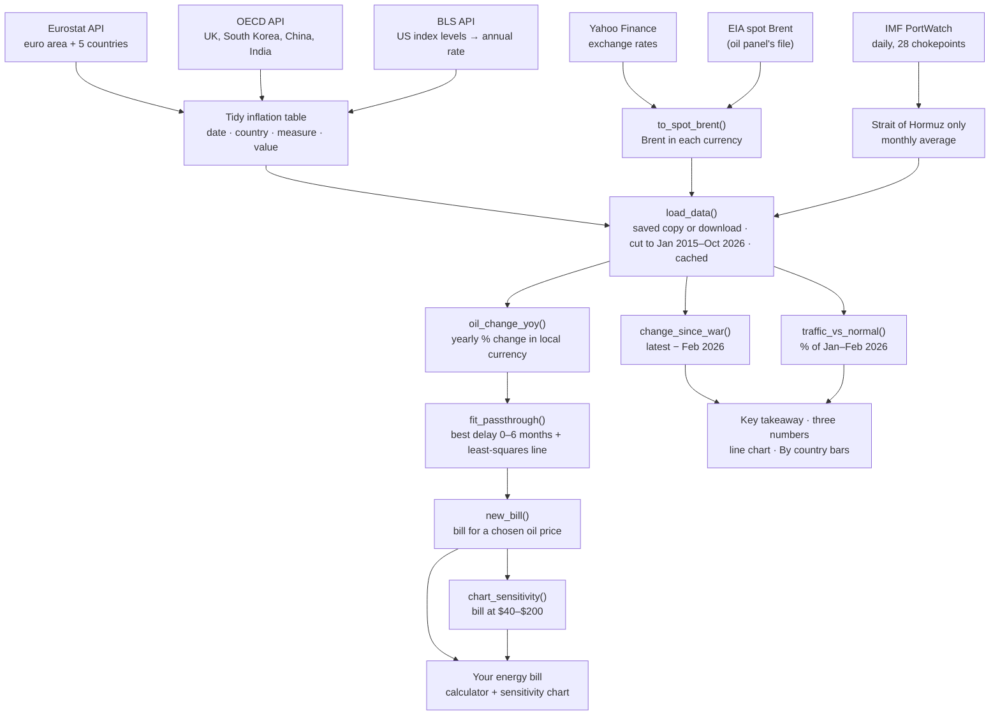

# Inflation and Households: Data Processing and Analysis

**Prepared by:** Eleena Golchin  
**Purpose:** Explain how the inflation panel's raw data is collected, processed, analysed and presented.

## 1. Overview

The panel investigates two related questions:

1. **How much of the Strait of Hormuz oil shock has fed through into the prices households pay?**
2. **How could a change in the oil price affect a household's energy bill?**

The panel combines monthly inflation data, Brent oil prices, exchange rates and tanker traffic through the Strait of Hormuz.

### How the panel works

| Stage | What happens | Main file |
|---|---|---|
| 1. Collect | Download data from the relevant statistical and market sources | `panels/inflation_data.py` |
| 2. Process | Standardise formats, clean values, align dates and save datasets | `panels/inflation_data.py` |
| 3. Analyse | Calculate changes since the war, tanker traffic measures and the oil-to-energy-inflation relationship | `panels/inflation.py` |
| 4. Present | Display the findings in summary figures, charts and the bill calculator | `panels/inflation.py` |



Tests are in `tests/test_inflation.py`.

---

## 2. Data sources

| Variable | Source | Coverage | Local file |
|---|---|---|---|
| Inflation | Eurostat, dataset `prc_hicp_minr` | Euro area, Ireland, Germany, France, Italy and Spain | `data/inflation_eurostat.csv` |
| Inflation | OECD Data Explorer | UK, South Korea, China and India | `data/inflation_oecd.csv` |
| Inflation | US Bureau of Labor Statistics (BLS) | United States | `data/inflation_bls.csv` |
| Brent crude oil price | US Energy Information Administration (EIA), via FRED; same Brent file used by the oil panel | International benchmark | `data/oil_monthly_brent_data.csv` |
| Exchange rates | Yahoo Finance, accessed through `yfinance` | EUR, GBP, KRW, CNY and INR | `data/inflation_oil.csv` |
| Tanker activity | IMF PortWatch | Strait of Hormuz | `data/inflation_hormuz.csv` |

Each inflation source covers four measures (headline, energy, food and services), and all data is cut at **31 October 2026**, like the other panels.

---

## 3. Collecting and standardising the data

Each source uses a different format, so each has its own download function. All three inflation downloads end up in the same four columns:

| date | country | measure | value |
|---|---|---|---:|
| 2026-10-01 | Ireland | Energy | 18.2 |

### 3.1 Eurostat: euro area and five countries

**Function:** `download_eurostat()`

The function requests annual inflation rates (`unit=RCH_A`) from January 2015 for the euro area, Ireland, Germany, France, Italy and Spain.

Eurostat returns its observations in **JSON-stat** format. In this structure, values are stored in a long list, and each value's position corresponds to a particular country, measure and month. The helper function `jsonstat_to_frame()` uses the dimensions supplied by Eurostat to map each value back to its labels.

```python
position = np.unravel_index(int(flat), j["size"])
```

This dataset is used because the older one ends in December 2025.

### 3.2 OECD: UK, South Korea, China and India

**Function:** `download_oecd()`

The OECD request uses the year-on-year CPI inflation rate (`GY`), which compares the price level with the same month one year earlier.

The CSV reply is trimmed to the needed columns, and the OECD codes are swapped for country and measure names.

### 3.3 BLS: United States

**Function:** `download_bls()`

The BLS only publishes price **index levels**, so the annual rate is calculated from them:

```python
rate = ((index / index.shift(12) - 1) * 100).dropna()
```

The free API provides a ten-year range, so the US series runs from January 2018 to September 2026.

October 2025 was never published (US government shutdown), so it is left missing rather than estimated. As a result, there is no US figure for October 2025 or October 2026.

### 3.4 Yahoo Finance: exchange rates and oil-currency conversion

**Function:** `download_oil()`

Daily exchange rates are downloaded, small gaps (such as holidays) are filled with the previous day, and the values are averaged by month. They are used to put Brent into each country's currency (section 4.4).

### 3.5 IMF PortWatch: Strait of Hormuz tanker activity

**Function:** `download_hormuz()`

The PortWatch file covers 28 chokepoints; only the **Strait of Hormuz** is kept. If the file is missing, the Hormuz rows are requested from the PortWatch website, 2,000 at a time.

---

## 4. Cleaning, aligning and combining the data

### 4.1 Applying a common date range

`up_to_end()` keeps only **January 2015 to October 2026** in every dataset, so all series share the same end date.

### 4.2 Using saved data or downloading live data

The `load()` function controls whether the panel reads local copies or downloads fresh observations.

| Setting | Processing approach |
|---|---|
| `LIVE = False` (default) | Read the saved CSV files in `data/`. The panel can run offline and produces repeatable results from the same files. |
| `LIVE = True` | Download updated data and save it locally. If a source is unavailable, use the saved copy instead. |

This follows the saved-copy approach from the module's lectures.

### 4.3 Combining the datasets

`load_data()` runs once and is cached, so moving a control doesn't reload anything. It:

1. **Combine inflation observations:** join the Eurostat, OECD and BLS tables into one dataset.
2. **Standardise data types:** convert dates into date values and observations into numeric values.
3. **Remove invalid observations:** drop values that cannot be treated as valid numbers.
4. **Convert Brent into local currencies:** combine the Brent spot price with the exchange-rate data.
5. **Aggregate tanker activity:** convert daily tanker observations into monthly averages so they align with the monthly inflation series.

If one source fails completely, the rest of the panel still works and a warning names the missing source.

### 4.4 Converting Brent into each country's currency

To match the oil panel, `to_spot_brent()` uses the EIA spot price. It turns Yahoo's prices into exchange rates (currency per US\$), then multiplies by spot Brent:

```python
rates = oil.div(oil["USD"], axis=0)                  # each currency per US$
return rates.mul(spot.reindex(oil.index), axis=0)    # × spot Brent
```

**October 2026 example:** Brent was **\$123.93** per barrel, equivalent to approximately:

| Currency | Converted Brent price |
|---|---:|
| Euro | €110.53 |
| Pound sterling | £93.24 |
| South Korean won | ₩165,682 |
| Chinese yuan | ¥828.91 |
| Indian rupee | ₹11,839.04 |

---

## 5. Implementing the analysis

All in `panels/inflation.py`.

### 5.1 Measuring the change since the war

**Function:** `change_since_war()`

$$
\text{Change since war} = \text{Latest value} - \text{February 2026 value}
$$

February 2026 is the last month before the war. The result is a **percentage-point** change (2% to 5% is +3 points). If there is no post-war data, nothing is returned rather than a misleading number.

**Example from the saved data:**
- Euro-area energy inflation: **21.0%**, an increase of **24.1 percentage points**.
- Euro-area headline inflation: **4.0%**, an increase of **2.1 percentage points**.

### 5.2 Measuring tanker traffic against normal levels

**Function:** `traffic_vs_normal()`

$$
\text{Traffic index} = \frac{\text{Monthly tanker capacity}}{\text{January–February 2026 average capacity}} \times 100
$$

**100 = the pre-war average.** It uses tanker **capacity** (how much oil they can carry), not the number of ships.

In the saved data, the measure falls from 115.9% in February to 1.5% in March, and reaches 0.7% in October 2026.

### 5.3 Calculating the year-on-year oil price change

**Function:** `oil_change_yoy()`

$$
\text{Oil price change} = \left(\frac{\text{Brent price this month}}{\text{Brent price 12 months earlier}} - 1\right) \times 100
$$

Brent is in each country's own currency, because exchange rates change what imported oil costs.

### 5.4 Estimating the oil-to-energy-inflation relationship

**Function:** `fit_passthrough()`

The main analysis: how strongly, and how quickly, oil prices feed into energy inflation. It has three stages.

**Stage 1: Test possible delays**

For each delay from **0 to 6 months**, it correlates energy inflation with the oil price change that many months earlier.

```python
for lag in range(MAX_LAG_MONTHS + 1):
    pair = pd.concat(
        [energy, oil_change.shift(lag)],
        axis=1,
        sort=True
    ).dropna()
    correlations[lag] = pair.iloc[:, 0].corr(pair.iloc[:, 1])
```

**Stage 2: Select the strongest correlation**

The delay with the highest correlation is kept: roughly how long bills take to follow oil.

**Stage 3: Fit a straight-line model**

With that delay, `np.polyfit()` fits a least-squares line through every month since 2016:

$$
\text{Energy inflation} = \text{Intercept} + (\text{Slope} \times \text{Oil price change})
$$

| Statistic | Interpretation |
|---|---|
| **Slope** | The estimated change in energy inflation, in percentage points, associated with a 1% change in oil prices. |
| **Intercept** | The model's estimated energy inflation when the oil price change is zero. |
| **R²** | The proportion of variation in energy inflation explained by the fitted line. A value closer to 1 indicates a closer fit to the observed data. |

### 5.5 Calculating a household's estimated new bill

**Function:** `new_bill()`

Applies the country's model to the chosen oil price in three steps:

1. Oil price change (the reference is spot Brent in the last month of the chosen period):

$$
\text{Oil price change} = \left(\frac{\text{Selected oil price}}{\text{Latest Brent spot price}} - 1\right) \times 100
$$

2. Energy inflation from the fitted line:

$$
\text{Estimated energy inflation} = \text{Intercept} + (\text{Slope} \times \text{Oil price change})
$$

3. The new bill:

$$
\text{Estimated new bill} = \text{Current bill} \times \left(1 + \frac{\text{Estimated energy inflation}}{100}\right)
$$

### 5.6 Producing the sensitivity chart

**Function:** `chart_sensitivity()`

Repeats the bill calculation for every oil price from **\$40 to \$200** in \$5 steps, so the user sees a range of outcomes rather than one number.

### 5.7 Generating the panel's headline results

- **`key_takeaway()`** counts how many countries' energy inflation rose since February 2026, and compares the euro-area rise in energy and headline inflation.
- **`story_numbers()`** gives the three headline figures (euro-area inflation, euro-area energy inflation, tanker traffic), each with its change since the war.

### 5.8 Comparing countries

**Function:** `chart_by_country()`

Calculates each country's change since February 2026 and sorts them. For energy inflation in October 2026, the increases range from **+9.1 percentage points in South Korea** to **+38.5 percentage points in Italy**.

---

## 6. Main model results and interpretation

Results of `fit_passthrough()` on the saved data:

| Country | Estimated delay | Slope | Intercept | R² |
|---|---:|---:|---:|---:|
| Spain | 0 months | 0.288 | 0.37 | 0.68 |
| Euro area | 1 month | 0.228 | 2.40 | 0.58 |
| France | 1 month | 0.179 | 3.15 | 0.64 |
| United States | 1 month | 0.246 | 2.44 | 0.71 |
| South Korea | 1 month | 0.153 | 0.50 | 0.58 |
| Ireland | 2 months | 0.232 | 3.32 | 0.48 |
| Germany | 5 months | 0.187 | 3.08 | 0.49 |
| Italy | 5 months | 0.305 | 2.95 | 0.52 |
| United Kingdom | 6 months | 0.275 | 3.16 | 0.43 |

China and India are left out because they don't publish energy inflation.

### What the results suggest

- **Oil and energy inflation move together in every country.** A 10% rise in oil is linked to about 1.5–3.1 more points of energy inflation (slopes 0.153–0.305).
- **Timing differs.** Spain reacts within the same month; Germany and Italy take five months and the UK six.
- **The delay isn't precise.** For Ireland, every delay from 0 to 6 months has a correlation between 0.64 and 0.69, so no single delay stands out. The panel calls the timing approximate.

- **Fit varies.** The line explains 71% of the variation in US energy inflation but only 43% in the UK.

---

## 7. Worked example: an Irish household

The calculator's starting view: **Ireland**, oil at **\$120** a year from now, a **€200** monthly bill, and the period ending in **October 2026**.

| Step | Calculation | Result |
|---|---|---:|
| Irish model | Estimated lag, slope and intercept | 2 months; 0.232; 3.32 |
| Reference oil price | October 2026 Brent spot price | \$123.93 |
| Oil price change | $`(120 / 123.93 - 1) \times 100`$ | −3.2% |
| Estimated energy inflation | $`3.32 + (0.232 \times -3.17)`$ | 2.6% |
| Estimated monthly bill | $`200 \times (1 + 2.59 / 100)`$ | **€205.17 (about €205)** |
| Extra cost over one year | $`12 \times (205.17 - 200)`$ | **About €62** |

Even with oil slightly cheaper, the bill still rises a little, because the intercept is positive: the Irish model expects about 3.3% energy inflation when oil doesn't change.

---

## 8. How the interactive controls affect the analysis

| Control | Effect on the panel |
|---|---|
| **Period** | The chart shows the months picked; the headline figures and bill use the last one. Ending in February 2026 shows the position just before the war. |
| **Countries** | Which countries appear on the line chart and are highlighted in the bars. |
| **Measure** | Selects headline, energy, food or services inflation. |
| **View** | *Over time* (line chart) or *By country* (bar chart). |
| **Calculator country** | Which country's model is used. Only countries with energy data are offered. |
| **Calculator oil price** | The oil price a year ahead, \$40 to \$200. |
| **Calculator monthly bill** | Today's bill; it starts at a typical bill for the currency (e.g. €200 or £170). |

Changing a control only reruns the calculations, so the panel updates straight away.

---

## 9. Updating the data

The panel uses the saved data by default (section 4.2). To download fresh data, set `LIVE = True` in `panels/inflation_data.py`, or run:

```bash
python3 -c "from panels.inflation_data import save_all; save_all()"
```

`save_all()` downloads every source, cuts it at 31 October 2026, saves it in `data/`, and reports what was saved or failed. The **Method and sources** box in the panel shows where each dataset was loaded from.

---

## 10. Testing and validation

`tests/test_inflation.py` has **15 tests** using small made-up datasets, so they need no internet. Run them with:

```bash
python3 -m pytest -q tests/test_inflation.py
```

### Model and bill-calculator tests

| Test | What it checks |
|---|---|
| `test_passthrough_finds_the_lag_and_slope_it_was_built_with` | The model can recover a known two-month lag and slope of 0.4 from constructed data. |
| `test_fit_passthrough_keeps_every_correlation` | The model tests each lag from zero to six and selects the strongest correlation. |
| `test_new_bill_with_no_oil_change` | With no oil-price change, the bill changes only according to the intercept (to €202 in the test case). |
| `test_higher_oil_means_a_higher_bill` | A higher oil price produces a higher estimated bill. |
| `test_bill_rises_steadily_with_the_oil_price` | Across the \$40–\$200 range, the estimated bill increases as the oil price rises. |

### Data-processing tests

| Test | What it checks |
|---|---|
| `test_jsonstat_to_frame` | Eurostat's JSON-stat response is converted into the required table. |
| `test_data_stops_at_october_2026` | Observations after October 2026 are excluded. |
| `test_saved_copy_is_used_when_the_website_fails` | The saved dataset is used when a download fails. |
| `test_bls_skips_months_that_were_not_published` | An unpublished US observation is left missing. |
| `test_download_hormuz_keeps_only_hormuz` | The PortWatch data is filtered to the Strait of Hormuz. |
| `test_hormuz_traffic_as_percent_of_normal` | Traffic equal to the pre-war average is represented by 100. |

### Panel-calculation tests

| Test | What it checks |
|---|---|
| `test_change_since_war` | Changes are measured relative to February 2026. |
| `test_in_period_keeps_both_ends` | The selected period includes both its first and last months. |
| `test_story_numbers_follow_the_end_of_the_period` | The three headline figures use the final month selected. |
| `test_key_takeaway_counts_every_country` | The headline takeaway counts the countries correctly. |

---

## 11. Methodological choices

| Choice | Reason |
|---|---|
| Use Eurostat's newer dataset | The older one ends in December 2025. |
| Use South Korea rather than Japan | The OECD stopped publishing Japan's figures in 2021. |
| Calculate US inflation from the index | The BLS only publishes index levels. |
| Leave unpublished months missing | Filling them would mean inventing data. |
| Use the oil panel's EIA Brent price | One oil price across the dashboard. |
| Convert oil into local currencies | Exchange-rate movements affect the oil price faced by each country. |
| Use tanker capacity rather than ship counts | Capacity better represents how much oil can pass through the Strait. |
| Use February 2026 as the pre-war reference | It is the last month before the war began on 28 February 2026. |
| Fit a straight-line model | Simple to explain, reproduce and check. |
| Use saved data by default | It makes the panel reproducible and usable offline. |

---

## 12. Limitations and interpretation

1. **A scenario, not a forecast.** The calculator applies a relationship from past data and assumes exchange rates and other costs stay the same.
2. **The delay is approximate.** Several delays fit almost equally well (section 6).
3. **Correlation is not causation.** Gas prices, taxes, price caps and suppliers also move energy prices.
4. **Some data is missing.** US data ends in September 2026 and October 2025 is missing; China has no energy or services figures, and India only headline and some food.
5. **Not perfectly comparable.** The UK, US and Asian figures are national price indexes, close to but not the same as the euro-area HICP.

## 13. Overall conclusion

The panel combines six sources into one monthly dataset and shows that oil prices are linked to energy inflation in every country, though how strongly and how quickly differs. The bill calculator turns that link into illustrative scenarios, not predictions of an exact bill.
