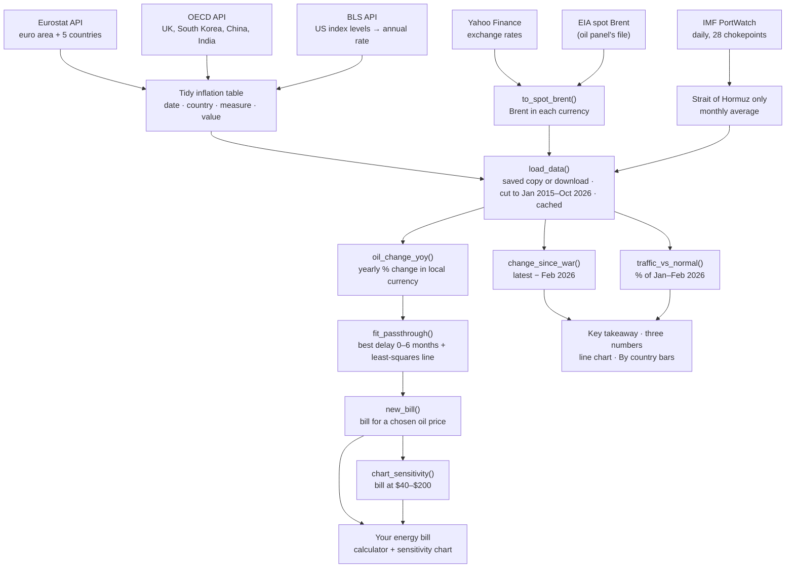

# Inflation and Households: Data Processing and Analysis

**Prepared by:** Eleena Golchin  
**Purpose:** Explain how the inflation panel's raw data is collected, processed, analysed and presented.

## 1. Overview

The panel investigates two related questions:

1. **How much of the Strait of Hormuz oil shock has fed through into the prices households pay?**
2. **How could a change in the oil price affect a household's energy bill?**

To answer these questions, the project combines monthly inflation data, Brent crude oil prices, exchange rates and tanker activity through the Strait of Hormuz. The data is standardised and aligned before calculations are carried out. The results are then displayed through summary figures, charts and an interactive household bill calculator.

### How the panel works

| Stage | What happens | Main file |
|---|---|---|
| 1. Collect | Download data from the relevant statistical and market sources | `panels/inflation_data.py` |
| 2. Process | Standardise formats, clean values, align dates and save datasets | `panels/inflation_data.py` |
| 3. Analyse | Calculate changes since the war, tanker traffic measures and the oil-to-energy-inflation relationship | `panels/inflation.py` |
| 4. Present | Display the findings in summary figures, charts and the bill calculator | `panels/inflation.py` |



**Code and tests**
- Data collection and processing: `panels/inflation_data.py`
- Analysis and panel display: `panels/inflation.py`
- Automated tests: `tests/test_inflation.py`

---

## 2. Data sources

The analysis uses five sources to build a consistent monthly dataset.

| Variable | Source | Coverage | Local file |
|---|---|---|---|
| Inflation | Eurostat, dataset `prc_hicp_minr` | Euro area, Ireland, Germany, France, Italy and Spain | `data/inflation_eurostat.csv` |
| Inflation | OECD Data Explorer | UK, South Korea, China and India | `data/inflation_oecd.csv` |
| Inflation | US Bureau of Labor Statistics (BLS) | United States | `data/inflation_bls.csv` |
| Brent crude oil price | US Energy Information Administration (EIA), via FRED; same Brent file used by the oil panel | International benchmark | `data/oil_monthly_brent_data.csv` |
| Exchange rates | Yahoo Finance, accessed through `yfinance` | EUR, GBP, KRW, CNY and INR | `data/inflation_oil.csv` |
| Tanker activity | IMF PortWatch | Strait of Hormuz | `data/inflation_hormuz.csv` |

The inflation datasets contain four measures:

- **Headline inflation:** the overall change in consumer prices.
- **Energy inflation:** the change in energy prices.
- **Food inflation:** the change in food prices.
- **Services inflation:** the change in services prices.

The common data cut-off is **31 October 2026**, matching the other three panels.

---

## 3. Collecting and standardising the data

Each provider supplies data in a different format. Separate download functions handle those differences and convert the inflation observations into one common structure:

| date | country | measure | value |
|---|---|---|---:|
| 2026-10-01 | Ireland | Energy | 18.2 |

This standard format makes it possible to combine and analyse the countries consistently.

### 3.1 Eurostat: euro area and five countries

**Function:** `download_eurostat()`

The function requests annual inflation rates (`unit=RCH_A`) from January 2015 for the euro area, Ireland, Germany, France, Italy and Spain.

Eurostat returns its observations in **JSON-stat** format. In this structure, values are stored in a long list, and each value's position corresponds to a particular country, measure and month. The helper function `jsonstat_to_frame()` uses the dimensions supplied by Eurostat to map each value back to its labels.

```python
position = np.unravel_index(int(flat), j["size"])
```

The newer dataset, `prc_hicp_minr`, is used because the older Eurostat dataset ends in December 2025, while this one continues into 2026.

### 3.2 OECD: UK, South Korea, China and India

**Function:** `download_oecd()`

The OECD request uses the year-on-year CPI inflation rate (`GY`), which compares the price level with the same month one year earlier.

The response is a CSV file. The function selects the required columns and converts the OECD country and measure codes into readable names.

### 3.3 BLS: United States

**Function:** `download_bls()`

The BLS publishes consumer price **index levels**, rather than the inflation rates required for the panel. The year-on-year inflation rate is therefore calculated from the index:

```python
rate = ((index / index.shift(12) - 1) * 100).dropna()
```

In words:

$$
\text{Inflation rate} = \left(\frac{\text{Index this month}}{\text{Index 12 months earlier}} - 1\right) \times 100
$$

The free API provides a ten-year range, so the US series runs from January 2018 to September 2026.

There is also a missing observation: October 2025 was not published because of the US government shutdown. The code leaves this month missing rather than estimating or inventing a value. As a result, there is no US year-on-year figure for October 2025 or October 2026.

### 3.4 Yahoo Finance: exchange rates and oil-currency conversion

**Function:** `download_oil()`

Daily exchange-rate observations are downloaded using `yfinance`. Small gaps, such as market holidays, are filled using the previous available day's value. The daily observations are then averaged to produce monthly exchange rates.

These rates allow the Brent price to be expressed in each country's currency, rather than comparing every country using the US dollar price alone.

### 3.5 IMF PortWatch: Strait of Hormuz tanker activity

**Function:** `download_hormuz()`

The PortWatch dataset covers 28 shipping chokepoints. The function filters the data to retain only observations for the **Strait of Hormuz**.

If the local PortWatch file is unavailable, the function requests the Hormuz observations from the PortWatch website in batches of 2,000 rows.

---

## 4. Cleaning, aligning and combining the data

Collecting the data is only the first step. Before analysis, the datasets need to use compatible dates, formats and units.

### 4.1 Applying a common date range

The function `up_to_end()` retains observations from **January 2015 to October 2026**.

Applying the same date range to every dataset gives the panel a consistent end date and prevents later observations from appearing in one series but not another.

### 4.2 Using saved data or downloading live data

The `load()` function controls whether the panel reads local copies or downloads fresh observations.

| Setting | Processing approach |
|---|---|
| `LIVE = False` (default) | Read the saved CSV files in `data/`. The panel can run offline and produces repeatable results from the same files. |
| `LIVE = True` | Download updated data and save it locally. If a source is unavailable, use the saved copy instead. |

This saved-data approach follows the method used in the module's lectures. It also makes the analysis reproducible: the same saved inputs can be used to obtain the same results.

### 4.3 Combining the datasets

The `load_data()` function loads the data once and caches it, avoiding repeated downloads or file reads when a user changes a panel control.

It then carries out the following processing steps:

1. **Combine inflation observations:** join the Eurostat, OECD and BLS tables into one dataset.
2. **Standardise data types:** convert dates into date values and observations into numeric values.
3. **Remove invalid observations:** drop values that cannot be treated as valid numbers.
4. **Convert Brent into local currencies:** combine the Brent spot price with the exchange-rate data.
5. **Aggregate tanker activity:** convert daily tanker observations into monthly averages so they align with the monthly inflation series.

If one data source fails completely, the remaining parts of the panel can still operate. The panel displays a warning identifying the missing source.

### 4.4 Converting Brent into each country's currency

The panel uses the EIA Brent spot price, keeping it consistent with the oil panel. The function `to_spot_brent()` combines this price with the Yahoo Finance exchange rates.

The calculation first expresses each currency relative to one US dollar, then multiplies the exchange rate by the Brent spot price:

```python
rates = oil.div(oil["USD"], axis=0)                  # each currency per US$
return rates.mul(spot.reindex(oil.index), axis=0)    # × spot Brent
```

This matters because exchange rates affect the price of oil in local currency. For example, if the euro weakens against the US dollar, Brent can become more expensive in euros even if its dollar price does not change.

**October 2026 example:** Brent was **\$123.93** per barrel, equivalent to approximately:

| Currency | Converted Brent price |
|---|---:|
| Euro | €110.53 |
| Pound sterling | £93.24 |
| South Korean won | ₩165,682 |
| Chinese yuan | ¥828.91 |
| Indian rupee | ₹11,839.04 |

---

## 5. Implementing the analysis

The calculations below are implemented in `panels/inflation.py`. They turn the processed data into comparable measures and panel outputs.

### 5.1 Measuring the change since the war

**Function:** `change_since_war()`

The change is calculated as:

$$
\text{Change since war} = \text{Latest value} - \text{February 2026 value}
$$

February 2026 is used as the pre-war reference point because it is the last month before the war began on 28 February 2026.

The result is a **percentage-point change**, not a percentage change. For example, a rise from 2% to 5% is an increase of 3 percentage points.

If there is no post-war observation available, the function returns no result rather than displaying a misleading comparison.

**Example from the saved data:**
- Euro-area energy inflation: **21.0%**, an increase of **24.1 percentage points**.
- Euro-area headline inflation: **4.0%**, an increase of **2.1 percentage points**.

### 5.2 Measuring tanker traffic against normal levels

**Function:** `traffic_vs_normal()`

Tanker capacity is compared with the average for January and February 2026:

$$
\text{Traffic index} = \frac{\text{Monthly tanker capacity}}{\text{January–February 2026 average capacity}} \times 100
$$

The measure is an index where:

- **100** represents the pre-war average.
- A value below 100 represents lower capacity than the pre-war average.
- A value above 100 represents higher capacity than the pre-war average.

The calculation uses tanker **capacity**, meaning how much oil the tankers can carry, rather than simply counting the number of ships.

In the saved data, the measure falls from 115.9% in February to 1.5% in March, and reaches 0.7% in October 2026.

### 5.3 Calculating the year-on-year oil price change

**Function:** `oil_change_yoy()`

For each country, the calculation uses Brent expressed in that country's own currency:

$$
\text{Oil price change} = \left(\frac{\text{Brent price this month}}{\text{Brent price 12 months earlier}} - 1\right) \times 100
$$

Using local currency is important because exchange-rate movements affect the cost of imported oil for each country.

### 5.4 Estimating the oil-to-energy-inflation relationship

**Function:** `fit_passthrough()`

This is the main statistical analysis in the panel. It estimates the relationship between changes in oil prices and energy inflation, including the delay between the two.

The model is implemented in three stages.

**Stage 1: Test possible delays**

The code tests delays, or lags, from **zero to six months**. For each lag, it compares energy inflation with the oil price change from that many months earlier. It calculates the correlation between the two series using observations where both values are available.

```python
for lag in range(MAX_LAG_MONTHS + 1):
    pair = pd.concat(
        [energy, oil_change.shift(lag)],
        axis=1,
        sort=True
    ).dropna()
    correlations[lag] = pair.iloc[:, 0].corr(pair.iloc[:, 1])
```

**Stage 2: Select the strongest correlation**

The lag with the highest correlation is selected as the model's estimated delay. This gives an indication of how long it takes for oil price movements to be reflected in energy inflation.

**Stage 3: Fit a straight-line model**

Using the selected lag, the code fits a least-squares line to the monthly observations from 2016 onwards, using `np.polyfit()`.

The model is:

$$
\text{Energy inflation} = \text{Intercept} + (\text{Slope} \times \text{Oil price change})
$$

The model produces three key statistics:

| Statistic | Interpretation |
|---|---|
| **Slope** | The estimated change in energy inflation, in percentage points, associated with a 1% change in oil prices. |
| **Intercept** | The model's estimated energy inflation when the oil price change is zero. |
| **R²** | The proportion of variation in energy inflation explained by the fitted line. A value closer to 1 indicates a closer fit to the observed data. |

The result is a simple, interpretable estimate of the historical relationship between oil prices and energy inflation. It should not be interpreted as proof that oil prices alone cause changes in household energy prices.

### 5.5 Calculating a household's estimated new bill

**Function:** `new_bill()`

The bill calculator applies the country-specific model to a user-selected future oil price.

It follows three steps:

1. Calculate the difference between the selected oil price and the latest Brent spot price in the selected period:

$$
\text{Oil price change} = \left(\frac{\text{Selected oil price}}{\text{Latest Brent spot price}} - 1\right) \times 100
$$

2. Use the fitted model to estimate energy inflation:

$$
\text{Estimated energy inflation} = \text{Intercept} + (\text{Slope} \times \text{Oil price change})
$$

3. Apply the estimated inflation rate to the current monthly bill:

$$
\text{Estimated new bill} = \text{Current bill} \times \left(1 + \frac{\text{Estimated energy inflation}}{100}\right)
$$

The reference oil price is the Brent spot price in the final month of the period selected in the panel.

### 5.6 Producing the sensitivity chart

**Function:** `chart_sensitivity()`

The sensitivity chart repeats the bill calculation for oil prices from **\$40 to \$200**, increasing in steps of \$5.

It plots the estimated bill across this range. This allows the user to see how the model's result changes under different oil-price assumptions, rather than relying on a single scenario.

### 5.7 Generating the panel's headline results

Two functions create the key summary outputs:

- **`key_takeaway()`** counts how many countries have experienced a rise in energy inflation since February 2026. It also compares the euro area's change in energy inflation with its change in headline inflation.
- **`story_numbers()`** produces the three headline figures: euro-area headline inflation, euro-area energy inflation and tanker traffic. Each is shown alongside its change since the war.

### 5.8 Comparing countries

**Function:** `chart_by_country()`

This function calculates the change since February 2026 for each country, then sorts the results from the largest increase to the smallest.

For energy inflation in October 2026, the increases range from **+9.1 percentage points in South Korea** to **+38.5 percentage points in Italy**.

---

## 6. Main model results and interpretation

The following table summarises the fitted oil-to-energy-inflation model for each country using the saved data.

| Country | Estimated delay | Slope | Intercept | R² |
|---|---:|---:|---:|---:|
| Spain | 0 months | 0.288 | 0.37 | 0.68 |
| Euro area | 1 month | 0.228 | 2.40 | 0.58 |
| France | 1 month | 0.179 | 3.15 | 0.64 |
| United States | 1 month | 0.246 | 2.44 | 0.71 |
| South Korea | 1 month | 0.153 | 0.50 | 0.58 |
| Ireland | 2 months | 0.232 | 3.32 | 0.48 |
| Germany | 5 months | 0.187 | 3.08 | 0.49 |
| Italy | 5 months | 0.305 | 2.95 | 0.52 |
| United Kingdom | 6 months | 0.275 | 3.16 | 0.43 |

China and India are excluded from this model because they do not publish the energy-inflation data required for the analysis.

### What the results suggest

- **A positive relationship is estimated in every country shown.** The slopes range from 0.153 to 0.305. In the fitted models, a 10% rise in oil prices is associated with approximately a 1.5–3.1 percentage-point increase in energy inflation, based on the selected lag.
- **The estimated timing differs across countries.** Spain has a selected lag of zero months, while Germany and Italy have five months and the UK has six months.
- **The estimated lag is not necessarily precise.** For Ireland, correlations across all tested lags from zero to six months range from 0.64 to 0.69. Since these values are quite close, the data does not identify one delay decisively. The panel therefore describes the timing as approximate.

The R² values also differ between countries. For example, the model explains 71% of the observed variation in US energy inflation, compared with 43% in the UK. The remaining variation may reflect other influences not included in this simple model.

---

## 7. Worked example: an Irish household

The panel's starting example uses:
- Country: **Ireland**
- Selected future oil price: **\$120 per barrel**
- Current monthly household bill: **€200**
- Selected period ending: **October 2026**

The calculation uses Ireland's fitted model and the October 2026 Brent spot price.

| Step | Calculation | Result |
|---|---|---:|
| Irish model | Estimated lag, slope and intercept | 2 months; 0.232; 3.32 |
| Reference oil price | October 2026 Brent spot price | \$123.93 |
| Oil price change | $`(120 / 123.93 - 1) \times 100`$ | −3.2% |
| Estimated energy inflation | $`3.32 + (0.232 \times -3.17)`$ | 2.6% |
| Estimated monthly bill | $`200 \times (1 + 2.59 / 100)`$ | **€205.17 (about €205)** |
| Extra cost over one year | $`12 \times (205.17 - 200)`$ | **About €62** |

Even though the selected oil price is slightly below the October 2026 reference price, the model still estimates a small increase in the bill. This is because the intercept is positive: the fitted Irish model estimates energy inflation of around 3.3% when the oil price change is zero.

The panel presents this scenario as an estimate based on the October 2026 reference point: oil at approximately \$124 per barrel, estimated energy inflation of 2.6%, and an approximate two-month delay.

---

## 8. How the interactive controls affect the analysis

The controls let the user explore different parts of the dataset and different bill scenarios.

| Control | Effect on the panel |
|---|---|
| **Period** | Sets the date range shown in the chart. The final month selected also determines the month used for the headline figures and bill calculator. Selecting February 2026 shows the position just before the war. |
| **Countries** | Determines which countries appear in the time-series chart and which countries are highlighted in the country comparison. |
| **Measure** | Selects headline, energy, food or services inflation. |
| **View** | Switches between the time-series line chart (*Over time*) and the country comparison bar chart (*By country*). |
| **Calculator country** | Selects the country-specific model used for the bill estimate. Only countries with energy-inflation data are available. |
| **Calculator oil price** | Sets the assumed oil price one year ahead, from \$40 to \$200. |
| **Calculator monthly bill** | Sets the household's current monthly bill. The starting value is a typical bill in the selected country's currency, such as €200 or £170. |

The underlying data is loaded once and cached. Changing a control reruns the relevant calculations and updates the panel without downloading the data again.

---

## 9. Updating the data

The panel uses saved data by default. This makes the results consistent between runs and means the panel can operate without an internet connection.

To download fresh data, either:

- Change `LIVE = False` to `LIVE = True` near the top of `panels/inflation_data.py`; or
- Run the following command:

```bash
python3 -c "from panels.inflation_data import save_all; save_all()"
```

The `save_all()` function downloads the source datasets, applies the cut-off of 31 October 2026, saves the resulting files in `data/` and reports which files were saved or whether a source failed.

If a website is unavailable, the panel falls back to the saved copy. The **Method and sources** box at the bottom of the panel identifies where each dataset was loaded from.

---

## 10. Testing and validation

The project includes **15 automated tests** in `tests/test_inflation.py`. They use small, constructed datasets, so they do not require an internet connection and run in under a second.

Run the tests with:

```bash
python3 -m pytest -q tests/test_inflation.py
```

### Model and bill-calculator tests

| Test | What it checks |
|---|---|
| `test_passthrough_finds_the_lag_and_slope_it_was_built_with` | The model can recover a known two-month lag and slope of 0.4 from constructed data. |
| `test_fit_passthrough_keeps_every_correlation` | The model tests each lag from zero to six and selects the strongest correlation. |
| `test_new_bill_with_no_oil_change` | With no oil-price change, the bill changes only according to the intercept (to €202 in the test case). |
| `test_higher_oil_means_a_higher_bill` | A higher oil price produces a higher estimated bill. |
| `test_bill_rises_steadily_with_the_oil_price` | Across the \$40–\$200 range, the estimated bill increases as the oil price rises. |

### Data-processing tests

| Test | What it checks |
|---|---|
| `test_jsonstat_to_frame` | Eurostat's JSON-stat response is converted into the required table. |
| `test_data_stops_at_october_2026` | Observations after October 2026 are excluded. |
| `test_saved_copy_is_used_when_the_website_fails` | The saved dataset is used when a download fails. |
| `test_bls_skips_months_that_were_not_published` | An unpublished US observation is left missing. |
| `test_download_hormuz_keeps_only_hormuz` | The PortWatch data is filtered to the Strait of Hormuz. |
| `test_hormuz_traffic_as_percent_of_normal` | Traffic equal to the pre-war average is represented by 100. |

### Panel-calculation tests

| Test | What it checks |
|---|---|
| `test_change_since_war` | Changes are measured relative to February 2026. |
| `test_in_period_keeps_both_ends` | The selected period includes both its first and last months. |
| `test_story_numbers_follow_the_end_of_the_period` | The three headline figures use the final month selected. |
| `test_key_takeaway_counts_every_country` | The headline takeaway counts the countries correctly. |

Together, these tests check that the data is transformed as expected, the main calculations behave correctly on known examples, and the panel responds consistently to its selected period.

---

## 11. Methodological choices

Several decisions were made to keep the analysis consistent, transparent and reproducible.

| Choice | Reason |
|---|---|
| Use Eurostat's newer dataset | The older dataset ends in December 2025, while the newer one continues into 2026. |
| Use South Korea rather than Japan | The OECD stopped publishing Japan's figures in 2021. |
| Calculate US inflation from the index | The BLS publishes price-index levels rather than the required inflation rates. |
| Leave unpublished observations missing | Filling gaps without an observed value would mean estimating or inventing data. |
| Use the EIA Brent price from the oil panel | This keeps the oil-price measure consistent across the dashboard. |
| Convert oil into local currencies | Exchange-rate movements affect the oil price faced by each country. |
| Use tanker capacity rather than ship counts | Capacity better represents how much oil can pass through the Strait. |
| Use February 2026 as the pre-war reference | It is the last month before the war began on 28 February 2026. |
| Fit a straight-line model | It is relatively simple to explain, reproduce and check. |
| Use saved data by default | It makes the panel reproducible and usable offline. |

---

## 12. Limitations and interpretation

The results are useful for exploring the historical relationship between oil prices, energy inflation and household bills. However, they should be interpreted with the following limitations in mind.

1. **The bill calculator is a scenario estimate, not a forecast.** It applies a relationship estimated from historical data. It does not predict future exchange rates or account for all other changes that may affect household bills, such as wages or other energy costs.
2. **The estimated delay is approximate.** Several tested lags can have very similar correlations, so the selected lag should not be treated as an exact measure of how quickly prices adjust.
3. **Correlation does not establish causation.** Gas prices, taxes, government price caps, regulation and supplier decisions can also affect energy prices. The model does not isolate the effect of oil from all these influences.
4. **Data availability differs by country.** US data ends in September 2026, and October 2025 is missing. China has no energy or services figures, while India's available series are limited to headline inflation and some food figures.
5. **The inflation measures are not perfectly comparable.** The UK, US and Asian figures use national price indexes. These are similar in purpose to the euro-area measures, but they are not exactly the same measure.

## 13. Overall conclusion

The panel brings together several data sources, standardises them into a common monthly format and uses the combined dataset to examine changes in inflation and tanker activity since February 2026. It then estimates the historical relationship between oil-price changes and energy inflation for countries with the required data.

The analysis suggests that oil-price movements are positively associated with energy inflation, but the strength and timing of the relationship differ across countries. The household calculator translates those historical relationships into illustrative bill scenarios. Its results are best understood as a transparent way to explore possible outcomes, not as a prediction of the exact bill a household will pay.
