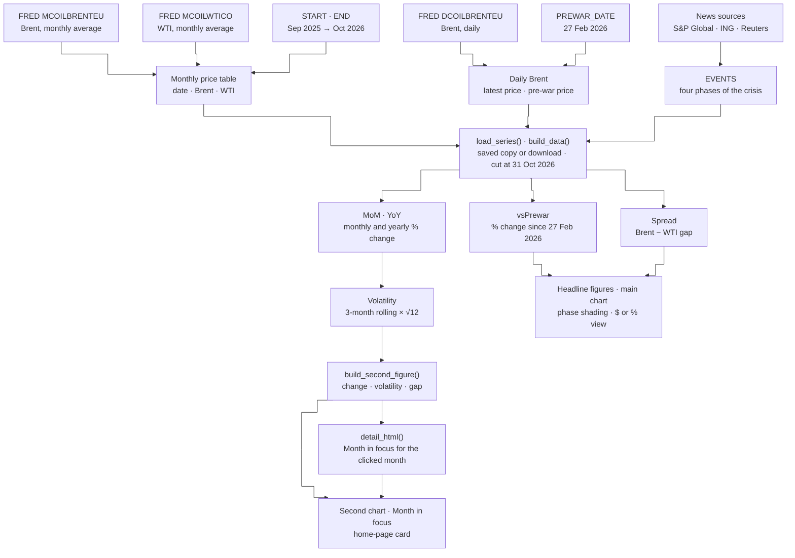

# Oil Prices: Data Processing and Analysis

**Prepared by:** Erin Dolly  
**Purpose:** Explain how the oil prices panel's raw data is collected, processed, analysed and presented.

## 1. Overview

The panel investigates two related questions:

1. **How did the price of crude oil respond to each phase of the 2026 Iran war and the near-closure of the Strait of Hormuz?**
2. **Did the shock hit the global oil price (Brent) harder than the US price (WTI)?**

The panel uses monthly and daily Brent prices and monthly WTI prices, all from the US Energy Information Administration (EIA) via FRED.

### How the panel works

| Stage | What happens | Main file |
|---|---|---|
| 1. Collect | Read the saved FRED files, or download fresh copies | `panels/oil.py` |
| 2. Process | Clean values, align dates, apply the cut-off and combine Brent with WTI | `panels/oil.py` |
| 3. Analyse | Calculate monthly and yearly changes, change since the war, volatility and the Brent–WTI gap | `panels/oil.py` |
| 4. Present | Display the findings in headline figures, two charts, a Month in focus panel and a home-page card | `panels/oil.py` |



There is no automated test file for this panel yet; the checks are listed in section 10.

---

## 2. Data sources

| Variable | Source | Coverage | Local file |
|---|---|---|---|
| Brent price, monthly average | EIA via FRED, series `MCOILBRENTEU` | May 1987 – Oct 2026 | `data/oil_monthly_brent_data.csv` |
| WTI price, monthly average | EIA via FRED, series `MCOILWTICO` | Jan 1986 – Oct 2026 | `data/oil_monthly_wti_data.csv` |
| Brent price, daily | EIA via FRED, series `DCOILBRENTEU` | Nov 2021 – Oct 2026 (trading days) | `data/oil_daily_brent_data.csv` |
| Dates of the crisis phases | S&P Global, ING Think, Reuters via Al-Monitor | 28 Feb, 8 Apr, 8 Jul 2026 | `data/oil_event_sources.csv` |

All prices are **spot prices in US dollars per barrel**, and all data is cut at **31 October 2026**, like the other panels. The monthly Brent file is also used by the inflation panel, so the whole dashboard uses one oil price.

---

## 3. Collecting and standardising the data

All three price files come from FRED and share the same simple layout, so one function reads all of them.

| observation_date | MCOILBRENTEU |
|---|---:|
| 2026-10-01 | 123.93 |

### 3.1 Reading the FRED files

**Function:** `read_fred_csv()`

The function reads a FRED CSV, either from `data/` or straight from FRED's website, and turns it into a pandas Series of prices indexed by date.

```python
values = pd.to_numeric(raw.iloc[:, 1], errors="coerce").values
series = pd.Series(values, index=pd.to_datetime(raw.iloc[:, 0], errors="coerce"))
series = series[series.index.notna()].dropna()
```

- Columns are used **by position**, because each file names its price column differently (`MCOILBRENTEU`, `MCOILWTICO`, `DCOILBRENTEU`).
- `errors="coerce"` turns blank cells, or the `.` FRED uses for missing values, into gaps, which `dropna()` then removes.

### 3.2 Aligning monthly dates

For the monthly files, every date is set to the **first day of its month**, and each month is reduced to one value:

```python
series.index = series.index.to_period("M").to_timestamp()
return series.groupby(level=0).mean().sort_index()
```

This makes Brent and WTI line up exactly by month. FRED's monthly files already have one value per month, so the averaging changes nothing for them, but it means the same function would also work if given daily data.

### 3.3 Keeping the daily file daily

**Daily Brent** is kept at daily level (`monthly=False`). It is used only to find the price on two specific days (section 5.1).

The daily file has **1,305 rows**, of which **41 are blank** (public holidays). After cleaning and the cut-off, **1,252 trading days** remain.

### 3.4 Downloading fresh data

**Function:** `download()`

When `LIVE = True`, each series is downloaded from FRED using its ID:

```python
f"https://fred.stlouisfed.org/graph/fredgraph.csv?id={series_id}"
```

The download is cut at 31 October 2026 and saved over the file in `data/`, in the same two-column format.

---

## 4. Cleaning, aligning and combining the data

### 4.1 Applying the cut-off date

**Function:** `up_to_end()`

Keeps only dates **on or before 31 October 2026** in every series. The daily file actually runs to 17 November 2026, so without this step the latest price would change whenever new data was added.

### 4.2 Using saved data or downloading live data

**Function:** `load_series()`

| Setting | Processing approach |
|---|---|
| `LIVE = False` (default) | Read the saved CSV files in `data/`. The panel runs offline and gives the same results every time. |
| `LIVE = True` | Download updated data from FRED, cut it at 31 Oct 2026 and save it. If the download fails, use the saved copy instead. |

The panel's footer says which was used ("saved copy in data/" or "downloaded from FRED").

### 4.3 Combining Brent and WTI

**Function:** `build_data()`

1. **Start with Brent:** create a table with one row per Brent month.
2. **Add WTI:** match WTI to Brent's months with `reindex`. A missing WTI month would show as a gap rather than an error.
3. **Keep going if WTI fails:** if the WTI file can't be read, the panel still works and the WTI figures show "n/a".
4. **Calculate the metrics** on the full history (section 5).
5. **Trim to the display window:** keep **September 2025 – October 2026** (14 months).

### 4.4 Why the metrics are calculated before trimming

Several measures look back in time: the yearly change for September 2025 needs September 2024, and the 3-month volatility needs the two months before. Calculating on the full history (back to 1987) first means every month on the charts has a complete set of figures.

---

## 5. Implementing the analysis

All in `panels/oil.py`.

### 5.1 Finding the latest and pre-war prices

These two prices come from the **daily** file, because they need the price on a particular day rather than a monthly average.

```python
LATEST_DATE, LATEST_PRICE = DAILY.index[-1], DAILY.iloc[-1]
PREWAR_DATE, PREWAR_PRICE = DAILY[:PREWAR_DATE].index[-1], DAILY[:PREWAR_DATE].iloc[-1]
```

| Price | Rule | Result |
|---|---|---:|
| **Latest price** | Last daily price on or before 31 Oct 2026 | **\$120.15** (30 Oct 2026) |
| **Pre-war price** | Last daily price on or before 27 Feb 2026, the last trading day before the war | **\$71.32** (27 Feb 2026) |

If the pre-war date fell on a weekend or holiday, the code would automatically use the trading day before it.

### 5.2 Measuring the monthly change

**Column:** `MoM`

$$
\text{Monthly change} = \left(\frac{\text{Brent this month}}{\text{Brent last month}} - 1\right) \times 100
$$

**Example:** March 2026: (103.13 ÷ 70.89 − 1) × 100 = **+45.5%**, the jump when the war began.

### 5.3 Measuring the yearly change

**Column:** `YoY`

$$
\text{Yearly change} = \left(\frac{\text{Brent this month}}{\text{Brent 12 months earlier}} - 1\right) \times 100
$$

**Example:** October 2026: (123.93 ÷ 64.54 − 1) × 100 = **+92.0%**.

### 5.4 Measuring the change since the war

**Column:** `vsPrewar`

$$
\text{Change since pre-war} = \left(\frac{\text{Brent this month}}{\text{Pre-war price (\$71.32)}} - 1\right) \times 100
$$

**Example:** October 2026: **+73.8%**. The same formula, applied to the latest daily price, gives the headline figure of **+68.5%**.

### 5.5 Measuring volatility

**Column:** `Volatility`

$$
\text{Volatility} = \text{standard deviation of the last 3 monthly changes} \times \sqrt{12}
$$

```python
df["Volatility"] = df["MoM"].rolling(window=3).std() * np.sqrt(12)
```

Multiplying by $\sqrt{12}$ **annualises** the figure, the usual way to report volatility. A higher value means prices were swinging more erratically. It rises from **8.6** in September 2025 to a peak of **94.2** in May 2026.

### 5.6 Measuring the Brent–WTI gap

**Column:** `Spread`

$$
\text{Brent–WTI gap} = \text{Brent} - \text{WTI}
$$

Brent depends more on Middle East supply than WTI does, so the gap is a simple measure of whether the shock hit the global price harder than the US price. It was about **\$4** before the war and **\$21.86** by October 2026.

### 5.7 Assigning months to phases

**Function:** `phase_for()`

The four phases are set in the `EVENTS` dictionary, each with a start date, end date, colour and description:

| Phase | Dates | Colour | Source for the date |
|---|---|---|---|
| Build-up | 1 Jan – 28 Feb 2026 | Yellow | Our choice: when prices began rising |
| War & closure | 28 Feb – 8 Apr 2026 | Red | S&P Global, 28 Feb 2026 |
| Ceasefire | 8 Apr – 8 Jul 2026 | Blue | ING Think, 8 Apr 2026 |
| Conflict resumes | 8 Jul – 31 Oct 2026 | Purple | Reuters via Al-Monitor, 12 Jul 2026 |

Each month belongs to the **first phase that covers it**, counting from the first day of the phase's starting month. February 2026 is therefore in **Build-up** (the war began on its last day), and July 2026 is in **Ceasefire** (which lasted until 8 July). Months before January 2026 show a "Before the war" note.

### 5.8 Generating the headline figures

| Figure | Calculation | Result |
|---|---|---:|
| Latest Brent price | Latest daily price (section 5.1) | **\$120.15** |
| Change since pre-war | (120.15 ÷ 71.32 − 1) × 100 | **+68.5%** |
| Highest monthly average | Largest Brent value in the display window | **\$123.93** (Oct 2026) |
| Brent–WTI gap | Latest available `Spread` | **\$21.86** (Oct 2026) |

---

## 6. Main results and interpretation

The final `OIL` table on the saved data:

| Month | Brent | WTI | Gap | Monthly change | Yearly change | Volatility | vs pre-war |
|:--|--:|--:|--:|--:|--:|--:|--:|
| Sep 2025 | \$67.99 | \$63.96 | \$4.03 | +0.2% | −8.2% | 8.6 | −4.7% |
| Oct 2025 | \$64.54 | \$60.89 | \$3.65 | −5.1% | −14.7% | 10.0 | −9.5% |
| Nov 2025 | \$63.80 | \$60.06 | \$3.74 | −1.2% | −14.2% | 9.5 | −10.5% |
| Dec 2025 | \$62.54 | \$57.97 | \$4.57 | −2.0% | −15.3% | 7.2 | −12.3% |
| Jan 2026 | \$66.60 | \$60.04 | \$6.56 | +6.5% | −16.0% | 16.2 | −6.6% |
| Feb 2026 | \$70.89 | \$64.51 | \$6.38 | +6.4% | −6.0% | 16.9 | −0.6% |
| Mar 2026 | \$103.13 | \$91.38 | \$11.75 | +45.5% | +41.8% | 78.0 | +44.6% |
| Apr 2026 | \$117.29 | \$100.32 | \$16.97 | +13.7% | +72.2% | 71.9 | +64.5% |
| May 2026 | \$107.14 | \$102.13 | \$5.01 | −8.7% | +66.2% | 94.2 | +50.2% |
| Jun 2026 | \$85.40 | \$84.81 | \$0.59 | −20.3% | +19.5% | 59.9 | +19.7% |
| Jul 2026 | \$83.76 | \$80.46 | \$3.30 | −1.9% | +17.9% | 32.2 | +17.4% |
| Aug 2026 | \$91.08 | \$83.90 | \$7.18 | +8.7% | +34.2% | 50.9 | +27.7% |
| Sep 2026 | \$114.16 | \$97.31 | \$16.85 | +25.3% | +67.9% | 47.6 | +60.1% |
| Oct 2026 | \$123.93 | \$102.07 | \$21.86 | +8.6% | +92.0% | 33.4 | +73.8% |

### What the results suggest

- **The war caused an immediate, very large shock.** Brent's monthly average jumped **45.5%** in March 2026, the biggest monthly rise since May 2020, and the daily spot price peaked at **\$138.21** on 7 April.
- **Prices tracked the phases of the conflict.** They fell back by about 29% from April to July during the ceasefire, then climbed again once strikes resumed, reaching **\$123.93** in October 2026, the highest monthly average since March 2012.
- **The shock hit Brent harder than WTI.** The gap widened from about \$4 before the war to \$17 in April and \$21.86 in October, but almost closed during the ceasefire (\$0.59 in June). This fits Brent's closer link to Middle East supply.
- **Markets were most unsettled after the war began, not at the peak price.** Volatility peaked in May 2026 (94.2), when prices were falling sharply, while the highest prices in October came with lower volatility (33.4), suggesting a steadier climb.

---

## 7. Worked example: Month in focus for April 2026

Clicking April 2026 on either chart shows:

| Step | Calculation | Result |
|---|---|---:|
| Brent average | From the monthly Brent file | **\$117.29** |
| WTI average | From the monthly WTI file | **\$100.32** |
| vs previous month | (117.29 ÷ 103.13 − 1) × 100 | **+13.7%** |
| vs same month last year | (117.29 ÷ 68.13 − 1) × 100 | **+72.2%** |
| vs pre-war price | (117.29 ÷ 71.32 − 1) × 100 | **+64.5%** |
| Phase | `phase_for("2026-04-01")` | **War & closure** |
| Brent–WTI gap | 117.29 − 100.32 | **\$16.97** |

April 2025's Brent average (\$68.13) comes from the full history, which is why the metrics are calculated before trimming (section 4.4).

---

## 8. How the interactive controls affect the analysis

| Control | Effect on the panel |
|---|---|
| **Phase buttons** | Shade the selected phase on the main chart in its colour, with its name above it. Click again to clear. |
| **Price view** | *\$ per barrel* shows prices; *% vs pre-war* applies the formula in section 5.4 to every point, with the dashed reference line at 0%. |
| **Compare with WTI** | Adds the WTI line to the main chart. |
| **Zoom (3M / 6M / All)** | Shows the last 3 months, the last 6 months or the whole period. |
| **Second chart** | Switches between *Monthly change* (red rises, green falls), *3-month volatility* and *Brent–WTI gap*. |
| **Clicking a point** | Selects that month on both charts and in Month in focus. |
| **Previous / Next** | Steps through the 14 months. |

Every click reruns the panel's code. The selected month is stored in `st.session_state`, so it is remembered between clicks.

### The home-page card

The group's `app.py` calls `render_card()` to show a summary on the home page: the latest Brent price with its change since pre-war, the Brent–WTI gap with its change since September 2025, and a small Brent chart with the four phases shaded, dotted lines at the key dates and a dashed pre-war line. The full panel is only drawn when it is opened as its own page (`if __name__ == "__main__":`).

---

## 9. Updating the data

The panel uses the saved data by default (section 4.2). To download fresh data, set `LIVE = True` at the top of `panels/oil.py` and run the panel once:

```bash
python3 -m streamlit run panels/oil.py
```

Each series is downloaded from FRED, cut at 31 October 2026 and saved in `data/`. Set `LIVE` back to `False` afterwards so the results stay fixed. The footer of the panel shows which data was used.

To extend the analysis to later months, change `END`. To change a phase, edit its entry in `EVENTS` and add its source to `data/oil_event_sources.csv`.

---

## 10. Testing and validation

The oil panel does not yet have its own automated test file. Its results were checked by hand against the data files, and the panel was tested by running it on its own and inside the group app.

| Check | How | Result |
|---|---|---|
| Prices match FRED | Compared all 14 monthly values with the downloaded files | All match exactly |
| Cut-off works | The daily file runs to 17 Nov 2026 | Latest price used is from 30 Oct 2026 |
| Missing values handled | The daily file has 41 blank holiday rows | Removed; 1,252 trading days remain |
| Latest and pre-war prices | Looked up 30 Oct and 27 Feb 2026 in the daily file | \$120.15 and \$71.32 |
| Calculations | Recalculated by hand, e.g. March monthly change, October yearly change | +45.5% and +92.0%, matching the panel |
| "Highest since March 2012" | Searched the monthly history for higher months | Last higher month: Mar 2012 (\$125.45) |
| "Biggest rise since 2020" | Ranked every monthly change since 1987 | Larger only in May 2020 and Aug 1990 |
| \$138.21 peak | Searched the daily file | Highest daily price, on 7 Apr 2026 |
| Phase dates | Checked each against a named news source | Final phase moved from 7 to 8 Jul to match the source |
| Panel runs | `python3 -m streamlit run panels/oil.py` and `python3 -m streamlit run app.py` | Figures, charts, clicks and the home-page card all work |

Checking the text against the data led to several corrections. Earlier drafts said October was the highest "since mid-2022" and called March's rise the biggest "in the series", and some unsourced claims were removed.

---

## 11. Methodological choices

| Choice | Reason |
|---|---|
| Use EIA data via FRED | Free, reliable, and each series has a permanent ID anyone can download. |
| Use spot prices | FRED's EIA series are spot prices, and they match the inflation panel. |
| Use monthly averages on the charts | Show the trend clearly without day-to-day noise, and match the other panels. |
| Use the daily file for the latest and pre-war prices | These need the price on a specific day, not a monthly average. |
| Use 27 Feb 2026 as the pre-war reference | The last trading day before the war began on 28 February 2026. |
| Compare Brent with WTI | Shows whether the shock hit the global price harder than the US price. |
| Calculate metrics before trimming | Gives every displayed month a complete set of figures. |
| Annualise volatility with $\sqrt{12}$ | The standard way to report volatility, so it can be compared with other figures. |
| Only include sourced or data-backed text | Every sentence on the panel can be checked. |
| Use saved data by default | Makes the panel reproducible and usable offline. |

---

## 12. Limitations and interpretation

1. **Monthly averages hide daily extremes.** April's average was \$117.29, but the daily price reached \$138.21.
2. **Spot, not futures.** News reports often quote futures prices, which can differ (e.g. a futures settlement of \$117.64 on 30 October against a spot price of \$120.15).
3. **Volatility is noisy.** With only three months in each window, one big change has a large effect.
4. **The pre-war date is a choice.** A different reference date would change the "vs pre-war" figures.
5. **Phases are approximate on a monthly chart.** A phase starting mid-month is assigned to whole months (section 5.7).
6. **Correlation is not causation.** Inventories, OPEC+ decisions and demand also move oil prices, and are not modelled.

## 13. Overall conclusion

The panel turns three FRED price files into one monthly dataset and shows that oil prices moved closely with each phase of the 2026 crisis: a 45.5% jump when the war began, a fall during the ceasefire, and a climb to the highest level since 2012 once fighting resumed. The widening Brent–WTI gap suggests the shock hit the global oil price harder than the US price.
