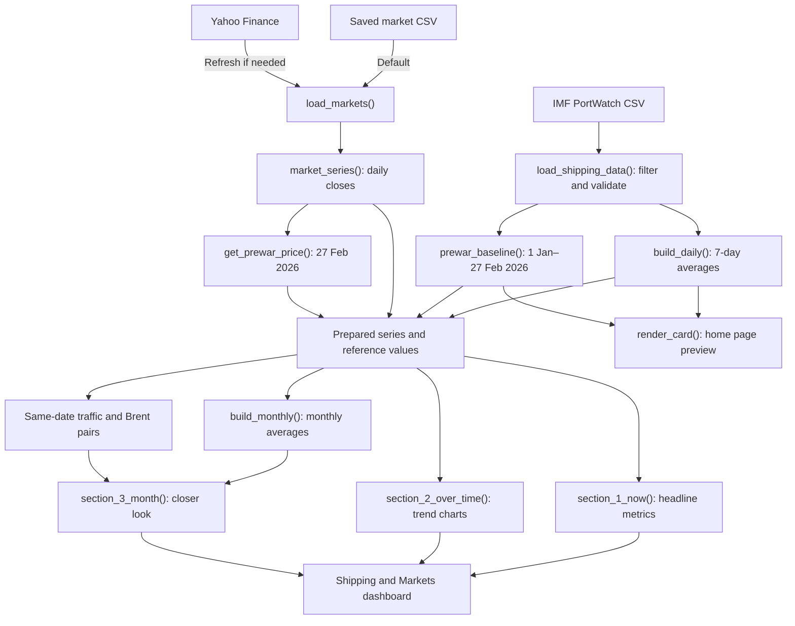

# Shipping and Markets: Data Processing and Analysis

**Prepared by:** Anna Piazza  
**Purpose:** Explain how the shipping panel's raw data is collected, processed, analysed and presented.

## 1. Overview

The panel investigates two related questions:

1. **How has vessel traffic through the Strait of Hormuz changed compared with pre-war levels?**
2. **How have Brent and WTI crude oil futures moved over the same period, and how do those movements relate to shipping activity?**

The panel combines daily vessel-transit counts from IMF PortWatch with market observations from Yahoo Finance.

### How the panel works

| Stage | What happens | Main file |
|---|---|---|
| 1. Collect | Read the PortWatch CSV and saved market data, or download fresh market prices | **panels/shipping.py** |
| 2. Process | Filter the Strait of Hormuz, validate observations, standardise dates and apply a common end date | **panels/shipping.py** |
| 3. Analyse | Calculate changes from pre-war levels, moving averages, tanker share, the Brent–WTI spread and monthly summaries | **panels/shipping.py** |
| 4. Present | Display the results in headline figures, interactive charts and downloadable tables | **panels/shipping.py** |

### Data flow

The shipping and market series are prepared separately. A date match is applied where needed, such as the traffic-versus-Brent scatter plot. The home page preview uses shipping data only.

Data processing uses **pandas** and **numpy**; market prices are retrieved through **yfinance**. Plotly produces the charts and Streamlit provides the interface.

The analysis is **descriptive, not causal**: it compares shipping and price movements without estimating the effect of one on the other.

---

## 2. Data sources

| Variable | Source | Coverage / use | Local file |
|---|---|---|---|
| Total vessel and tanker transits | IMF PortWatch, daily chokepoint data | Strait of Hormuz | **data/portwatch_daily_chokepoints.csv** |
| Brent crude oil futures | Yahoo Finance, **BZ=F** | Main oil-price benchmark; daily close | **data/shipping_markets.csv** |
| WTI crude oil futures | Yahoo Finance, **CL=F** | Comparison with Brent; daily close | **data/shipping_markets.csv** |
| VIX | Yahoo Finance, **^VIX** | Additional financial-market indicator | **data/shipping_markets.csv** |
| US Dollar Index | Yahoo Finance, **DX-Y.NYB** | Additional market indicator | **data/shipping_markets.csv** |

All series are cut at **31 October 2026**, like the other panels. The market-history setting requests two years of daily history from the download date.

The shipping panel measures the **number of vessel transits**, rather than tanker capacity or cargo volume. Brent and WTI are **futures prices**, not the EIA spot Brent price used by the oil and inflation panels.

---

## 3. Collecting and standardising the data

### 3.1 IMF PortWatch: Strait of Hormuz vessel activity

**Function:** **load_shipping_data()**

The PortWatch CSV covers daily activity at maritime chokepoints. The function keeps only observations whose **portname** contains "Hormuz", ignoring case.

| Column | Meaning |
|---|---|
| **portname** | Name of the chokepoint |
| **date** | Observation date |
| **n_total** | Total number of vessel transits |
| **n_tanker** | Number of tanker transits, included in the total |

The processing steps are:

1. Check that the file and required columns exist, and strip spaces from column names.
2. Filter the Strait of Hormuz.
3. Parse dates as UTC, remove the time zone and normalise to midnight.
4. Convert vessel counts to numbers, drop incomplete rows and sort by date.
5. Apply **END** and validate the remaining observations.

Duplicate dates are rejected to prevent double counting. The shipping load also fails if counts are negative, are not whole numbers, or if tankers exceed total vessels.

### 3.2 Yahoo Finance: oil futures and other market indicators

**Function:** **load_market_data(symbol)**

The function downloads the selected instrument's price history using **yfinance** and keeps the daily **Close** column. Prices are converted to numbers, missing and infinite values are removed, the date index is normalised and observations after **END** are excluded.

The download is cached for **300 seconds** using Streamlit's data cache. If a symbol is unavailable or has no Close column, the function returns an empty series.

### 3.3 Standardising the market prices

**Functions:** **clean_market_frame()** and **market_series()**

Both saved and downloaded data pass through the same cleaning process. The **date** index is normalised, invalid dates are dropped, duplicates are rejected, and observations are sorted and cut at **END**. The four columns (**BRENT**, **WTI**, **VIX** and **DOLLAR INDEX**) are kept in a fixed order, with any absent column created empty. Non-numeric and infinite values become missing.

Each instrument is then extracted as a separate series, dropping its own missing dates. This matters because the four instruments do not necessarily share the same trading calendar.

---

## 4. Cleaning, aligning and combining the data

### 4.1 Applying a common date range

| Setting | Value | Purpose |
|---|---|---|
| **BASELINE_START** – **BASELINE_END** | 1 January – 27 February 2026 | Pre-war traffic reference period |
| **PREWAR_DATE** | 27 February 2026 | Brent reference closing price |
| **WAR_START** | 28 February 2026 | Beginning of the war in the panel timeline |
| **END** | 31 October 2026 | Common end date across the panels |

The charts mark four predefined events: **28 February** (war begins), **8 April** (ceasefire), **17 June** (US–Iran MOU) and **8 July** (strikes resume).

| From | To | Phase | Colour |
|---|---|---|---|
| 1 January | 28 February | Build-up | Amber |
| 28 February | 8 April | War and closure | Red |
| 8 April | 8 July | Ceasefire | Blue |
| 8 July | 31 October | Conflict resumes | Purple |

These are manually defined project annotations, not events inferred from the datasets.

### 4.2 Using saved data or downloading fresh market data

**Function:** **load_markets()**

| Setting or condition | Processing approach |
|---|---|
| **LIVE = False** (default) | Use the saved market CSV when readable, for reproducible results. |
| **LIVE = True** | Download updated market observations and try to save them locally. |
| Saved copy missing or unreadable | Attempt a download even if **LIVE = False**. |
| Download fails | Use the saved copy, if available; otherwise market data is unavailable. |

A fresh download is valid only if all four instruments contain data and Brent has a usable close on 27 February 2026. The snapshot is written to a temporary file before replacement, to avoid a half-written CSV. If saving fails, valid downloaded prices are used for that run and the status message reports the problem.

### 4.3 Aligning calendar days and trading days

Shipping observations are recorded on calendar days, whereas market prices are available on trading days. Missing shipping days are not treated as zero, and missing market prices are not forward-filled.

When traffic is compared with Brent, or Brent is compared with WTI, the series are joined on their **common observation dates**. This avoids pairing unrelated days.

---

## 5. Implementing the analysis

The following sections explain the calculations performed in the shipping panel.

### 5.1 Calculating percentage changes

**Functions:** **pct()** and **percentage_change()**

**Percentage change (%) = (New value ÷ Old value − 1) × 100**

The formula is used for traffic and market-price comparisons. A market's daily change compares its last two available **trading observations**. For example, Monday's price is compared with the previous trading day, not Sunday.

A change is unavailable if the series is too short, a value is not finite or the previous value is non-positive.

### 5.2 Calculating daily traffic and the 7-day moving average

**Function:** **build_daily()**

The data are arranged on a calendar-day timeline. The trailing 7-day average is then calculated separately for total vessels and tankers.

**7-day moving average = Sum of the latest seven daily observations ÷ 7**

All seven daily observations must be available; otherwise the average is missing. This reduces day-to-day noise without inventing observations, although the moving average responds to sudden changes with a lag.

### 5.3 Measuring traffic against pre-war levels

**Function:** **prewar_baseline()**

The function calculates mean daily vessel and tanker transits from 1 January to 27 February 2026. At least **14 observed days** must be available in this window.

**Traffic change vs pre-war (%) = (Current 7-day average ÷ Pre-war daily average − 1) × 100**

**0% = the pre-war average.** A result of −60% means traffic is 60% below the reference, or 40% of its pre-war level.

### 5.4 Calculating the tanker share

**Tanker share (%) = (7-day average tanker transits ÷ 7-day average total transits) × 100**

The function uses a **ratio of averages**, rather than averaging seven daily percentages, so busier days have greater weight. The result measures the composition of vessel traffic, not its oil-carrying capacity.

### 5.5 Measuring Brent against its pre-war price

**Function:** **get_prewar_price()**

The reference is the Brent futures close on **27 February 2026**. No nearby observation or spot price is substituted.

**Brent change vs pre-war (%) = (Current Brent close ÷ Brent close on 27 February 2026 − 1) × 100**

Using the same futures series for both prices makes the comparison consistent. A missing reference price makes the percentage comparison unavailable.

### 5.6 Calculating the Brent–WTI spread

**Brent–WTI spread = Brent closing price − WTI closing price (on the same date)**

The headline spread uses the latest date on which **both** prices are available. It is measured in US dollars per barrel. A positive value indicates that Brent trades above WTI.

### 5.7 Producing the monthly summary

**Function:** **build_monthly()**

| Output | Calculation |
|---|---|
| **Total** | Mean total vessel transits per observed day |
| **Tankers** | Mean tanker transits per observed day |
| **Days** | Number of days with valid shipping data |
| **Share** | Monthly mean tanker transits / monthly mean total transits × 100 |
| **vsPrewar** | Percentage change in monthly mean traffic against the pre-war baseline |
| **Brent** | Mean of the month's available daily Brent closes |
| **DaysInMonth** | Calendar days in the month |

Daily averages, rather than monthly totals, make months of different lengths comparable. The panel also displays shipping coverage and the number of available Brent trading observations.

**Function:** **monthly_takeaway()**

Compares the selected month with the preceding month and describes the changes in average daily traffic and average Brent prices. The comparison is not made if a prior month is unavailable, shipping coverage is incomplete in either month, Brent is missing or a previous comparison value is non-positive.

### 5.8 Comparing shipping traffic and Brent prices

**Function:** **chart_second()** — Traffic vs Brent view

The scatter plot pairs the 7-day traffic average with the Brent close on the **same date**, removing missing and non-finite values.

Each point represents one date. Colours distinguish calendar months, and diamonds highlight the selected month. The chart visualises the association without fitting a regression, estimating a correlation coefficient or testing a time lag.

---

## 6. Main analytical outputs and interpretation

| Chart | Function | What it shows |
|---|---|---|
| Hormuz traffic | **chart_traffic()** | Daily vessel counts and 7-day averages, or % change from the pre-war baseline |
| Brent futures | **chart_brent()** | Brent's absolute price or % change from its pre-war close; optional WTI comparison |
| Traffic vs Brent | **chart_second()** | Same-date pairs of smoothed vessel traffic and Brent futures prices |
| Monthly traffic | **chart_second()** | Overlaid bars for average daily total and tanker transits; selected month highlighted |
| Tanker share | **chart_second()** | Area chart of the tanker percentage of total traffic |
| Brent daily change | **chart_second()** | Price changes between trading observations; red for rises and green for falls or no change |

### How to interpret the charts

- **Traffic:** daily counts reveal short-term fluctuations, while the moving average highlights sustained changes.
- **Pre-war comparisons:** percentage changes make it easier to compare the relative scale of movements in traffic and oil prices despite their different units.
- **Monthly traffic:** tanker transits are included within total vessel traffic, so the bars are overlaid rather than added together.
- **Price spread:** measures the difference between Brent and WTI, not the percentage change in either price.
- **Scatter plot:** an apparent relationship may reflect shared timing or broader market trends rather than a direct causal effect.

Shared Plotly styling (**style()** and **line()**) keeps the figures white even in dark mode and leaves gaps at missing observations. **finish()** adds phase shading, event markers and optional pre-war reference lines to the time-series views. For windows longer than 400 days, only the first event is labelled, if visible.

---

## 7. Worked example: interpreting the shipping and market figures

The following values are **hypothetical**, included to demonstrate the calculations rather than report actual observations.

Suppose the pre-war average is 80 vessels per day and the current 7-day average is 30 vessels, including 12 tankers. Brent's pre-war futures close is \$80 and its current close is \$120 per barrel.

| Step | Calculation | Result |
|---|---|---:|
| Traffic vs pre-war | (30 ÷ 80 − 1) × 100 | **−62.5%** |
| Tanker share | 12 ÷ 30 × 100 | **40.0%** |
| Brent vs pre-war | (120 ÷ 80 − 1) × 100 | **+50.0%** |
| Brent–WTI spread, if WTI closes at \$116 on the same date | 120 − 116 | **\$4 per barrel** |

Traffic is 62.5% below the pre-war average, tankers account for 40% of vessel activity and Brent is 50% above its reference price.

For two fully observed consecutive months, suppose average daily traffic changes from 40 to 30, while average Brent prices change from \$100 to \$120.

| Monthly comparison | Calculation | Result |
|---|---|---:|
| Change in average daily traffic | (30 ÷ 40 − 1) × 100 | −25.0% |
| Change in average Brent price | (120 ÷ 100 − 1) × 100 | +20.0% |

Traffic fell while Brent increased. This illustrates how the monthly takeaway is calculated without claiming that the fall in traffic caused the price increase.

---

## 8. How the interactive controls affect the analysis

| Section | Function | What is presented |
|---|---|---|
| **Where things stand** | **section_1_now()** | Latest ships, tankers, Brent and WTI; traffic vs pre-war, tanker share, Brent vs pre-war and the Brent–WTI spread |
| **Traffic and prices over time** | **section_2_over_time()** | Two side-by-side time-series charts with a shared date window and event timeline |
| **Closer look** | **section_3_month()** | Selected-month metrics, data coverage, an automatic takeaway and four detailed chart options |

Latest vessel and price metrics, and the spread, display their own observation dates. Daily traffic changes are shown only when the last two records are consecutive days. Metric delta colours are neutral.

### Interactive controls

| Control | Effect on the panel |
|---|---|
| **Time range** | Last 30, 90, 180 or 365 days, or all data; default is the last year. |
| **View** | Absolute figures or % changes relative to pre-war levels. |
| **Show tankers** | Adds tankers to the main traffic chart. |
| **Show 7-day averages** | Displays smoothed traffic; the % view uses averages when the baseline exists. |
| **Compare Brent with WTI** | Adds WTI to the Brent chart in absolute view. |
| **Month** | Changes monthly figures, coverage, the takeaway and highlighted observations; defaults to the latest month. |
| **Detailed chart** | Switches between Traffic vs Brent, Monthly traffic, Tanker share and Brent daily change. |

The monthly traffic chart displays up to 18 months, independent of the main time-range control. It highlights the selected month in orange.

### Supporting information and home page preview

Expanders display VIX, the Dollar Index, processed shipping observations and futures prices. Users can export **hormuz_shipping.csv** and **hormuz_futures_prices.csv**.

The **render_card()** function creates the home page preview: latest-month average vessel and tanker transits, comparisons with pre-war levels, and a filled chart of the total-traffic 7-day average over the last 365 days. It uses shipping data only.

---

## 9. Updating the data

The two input files are placed in the project's **data/** directory. The panel resolves this directory from its own location using the pathlib library.

To refresh the datasets:

1. Download the latest chokepoint CSV from [IMF PortWatch](https://portwatch.imf.org/) and save it as **data/portwatch_daily_chokepoints.csv**.
2. Set **LIVE = True** in the panel script and run the application.
3. Check the market-data status message to confirm the new snapshot was saved.
4. Set **LIVE = False** again to reproduce the results from the saved file.

To run the panel directly, launch the panel file with Streamlit from the directory containing the script.

To extend the analysis period, update **END**, the phase and event definitions, and both input datasets.

---

## 10. Testing and validation

The panel includes runtime data checks and error handling:

| Check | Expected behaviour |
|---|---|
| Missing shipping input or required columns | Report an error; available market sections can still render. |
| Duplicate dates | Reject ambiguous shipping or market observations. |
| Negative or non-integer vessel counts | Reject the shipping data. |
| Tanker count exceeds total count | Reject the shipping data. |
| Missing observation in a 7-day window | The moving average is missing. |
| Fewer than 14 observed baseline days | Pre-war traffic comparisons are unavailable. |
| Missing Brent close on 27 February | Brent's pre-war comparison is unavailable. |
| Brent and WTI have different latest dates | Calculate the spread on their latest common date. |
| Incomplete monthly shipping coverage | Display the coverage and omit the monthly takeaway. |
| Missing market instrument | Display a warning naming the series. |
| Neither shipping data nor Brent available | Stop the panel. |

Additional automated regression tests could verify these cases using small synthetic datasets, including known moving averages, baseline values and date-aligned price spreads. These are suggested tests, not results from a completed automated test suite.

---

## 11. Methodological choices

| Choice | Reason |
|---|---|
| Use PortWatch counts and separate tankers | Measure shipping activity and the composition of vessel traffic. |
| Use Brent and WTI futures | Compare two consistent market benchmarks and calculate their spread. |
| Use a complete 7-day moving average | Reduce daily noise without averaging incomplete weeks. |
| Use January–February 2026 traffic and the 27 February Brent close | Provide clearly defined pre-war references. |
| Calculate tanker share as a ratio of averages | Account for differences in daily transit counts. |
| Use monthly mean daily counts | Make months with different lengths comparable. |
| Match prices and traffic by date | Avoid comparisons between unrelated observation dates. |
| Leave missing days unfilled | Avoid inventing data or confusing missing values with zero. |
| Use saved data by default | Make the panel reproducible and usable offline when files are available. |
| Use shared events and colours | Maintain visual consistency with the other panels. |
| Keep the analysis descriptive | Avoid making unsupported causal claims. |

---

## 12. Limitations and interpretation

1. **Correlation is not causation.** Oil prices also respond to demand, inventories, supply decisions and expectations.
2. **Transit counts are not cargo volumes.** They do not show how much oil each tanker carries.
3. **Futures are not spot prices.** Continuous front futures series may be affected by changes of contract and should not be treated as identical to EIA spot Brent.
4. **The baseline is short.** Less than two months of pre-war traffic may not capture seasonal patterns.
5. **Data coverage differs.** Shipping uses calendar days and futures use trading days; monthly results are calculated from available observations.
6. **The scatter plot is time-dependent.** Shared trends or event timing can produce an apparent relationship.
7. **External data may be revised.** The panel relies on PortWatch and Yahoo Finance observations rather than independent measurements.

## 13. Overall conclusion

The panel brings together Strait of Hormuz vessel transits and oil futures prices to show how shipping activity and financial markets can be examined over the same period. Pre-war comparisons, moving averages and monthly summaries make changes easier to interpret, while date alignment, validation and saved datasets support reproducibility.

The analysis describes simultaneous changes in traffic and oil prices; it does not establish a causal relationship.
