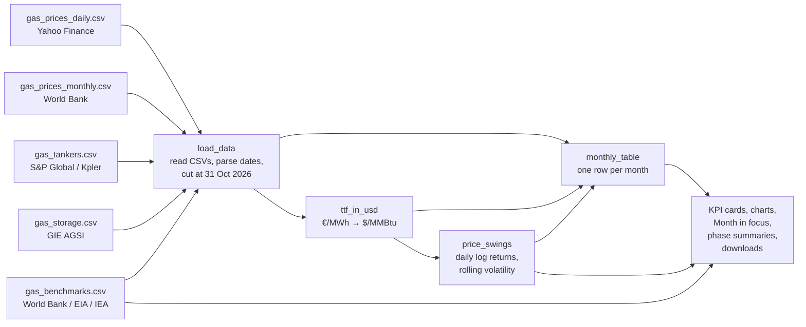

# Gas & LNG panel: data processing and analysis

**Author:** Eabha Kelly · **File:** `panels/gas_lng.py` · **Tests:** `tests/test_gas.py` · **Data cut-off:** 31 October 2026

This document explains, step by step, how the Gas & LNG panel of the Hormuz Shock dashboard turns five raw data files into the numbers, charts and summaries shown on screen. Every formula below is the one used in the code, and every worked example uses the saved data in `data/`, so the numbers match what the panel displays.

---

## Contents

1. [Overview of the pipeline](#1-overview-of-the-pipeline)
2. [The data files](#2-the-data-files)
3. [Loading and cleaning the data](#3-loading-and-cleaning-the-data)
4. [Converting European prices into dollars per MMBtu](#4-converting-european-prices-into-dollars-per-mmbtu)
5. [Building the monthly table](#5-building-the-monthly-table)
6. [Assigning each date to a phase of the crisis](#6-assigning-each-date-to-a-phase-of-the-crisis)
7. [Price changes](#7-price-changes)
8. [The Europe / US price ratio](#8-the-europe--us-price-ratio)
9. [LNG tanker traffic as a share of normal](#9-lng-tanker-traffic-as-a-share-of-normal)
10. [EU gas storage and the gap to normal](#10-eu-gas-storage-and-the-gap-to-normal)
11. [Volatility (price swings)](#11-volatility-price-swings)
12. [Phase summaries](#12-phase-summaries)
13. [Europe vs Asia: 2026 vs 2022](#13-europe-vs-asia-2026-vs-2022)
14. [The "% vs pre-war" view](#14-the--vs-pre-war-view)
15. [Where each number appears on the page](#15-where-each-number-appears-on-the-page)
16. [Chart logic that depends on the data](#16-chart-logic-that-depends-on-the-data)
17. [The downloadable tables](#17-the-downloadable-tables)
18. [Testing](#18-testing)
19. [Assumptions and limitations](#19-assumptions-and-limitations)
20. [Full monthly results](#20-full-monthly-results)
21. [Notation and settings](#21-notation-and-settings)

---

## 1. Overview of the pipeline



The panel works in four stages:

1. **Load:** read every CSV, convert dates and drop anything after the cut-off (`load_data`).
2. **Convert:** put European daily prices on the same unit as US prices (`ttf_in_usd`).
3. **Combine and calculate:** build one row per month with every measure the panel needs (`monthly_table`, `price_swings`, `storage_now`).
4. **Present:** the page reads only from these results, so every chart and card shows the same numbers.

---

## 2. The data files

All files are in `data/`. Every row has a `source` or `url` column, so each number can be traced back to where it came from.

| File | Rows | Columns used | Source | How it was collected |
|---|---|---|---|---|
| `gas_prices_daily.csv` | 281 trading days (1 Oct 2025 – 30 Oct 2026) | `date`, `ttf_eur_mwh`, `hh_usd_mmbtu`, `eurusd` | Yahoo Finance via `yfinance`: `TTF=F` (Dutch TTF futures, €/MWh), `NG=F` (US Henry Hub futures, $/MMBtu), `EURUSD=X` | Downloaded with `yfinance` (saved copy used by default) |
| `gas_prices_monthly.csv` | 10 months (Jan – Oct 2026) | `month`, `ttf_usd_per_mmbtu` | World Bank Pink Sheet (Natural gas, Europe = Dutch TTF), monthly average | Copied from the published series |
| `gas_tankers.csv` | 9 months (Feb – Oct 2026) | `month`, `tankers`, `tracker`, `note` | S&P Global Commodity Insights and Kpler, as reported in the news | Compiled by hand from linked reports |
| `gas_storage.csv` | 18 readings | `date`, `series`, `pct_full` | GIE AGSI, as reported by Argus, GMK Center, S&P Global, TASS and others | Compiled by hand; the `how` column says whether each value was reported or derived |
| `gas_benchmarks.csv` | 4 rows | `period`, `ttf_usd_per_mmbtu`, `jkm_usd_per_mmbtu` | World Bank, EIA, IEA; 2022 peak rounded | Compiled by hand |

**Units:**
- **€/MWh**: euros per megawatt-hour, the unit European gas (TTF) trades in.
- **$/MMBtu**: US dollars per million British thermal units, the unit US gas (Henry Hub) and Asian LNG (JKM) trade in.
- **% full**: EU gas storage as a percentage of total storage capacity.

**Storage series.** `gas_storage.csv` holds three series in long format: `2026`, `2025 (same date)` and `5-year average`. Three of the 5-year average values are **derived**, not reported directly:

$$
\text{5-year average}_d = \text{2026 level}_d + \text{reported gap}_d
$$

For example, on 6 October 2026: $73.0 + 15.11 = 88.1\%$. One 2025 value (1 April) was derived from the reported volume of gas in storage divided by EU storage capacity.

---

## 3. Loading and cleaning the data

**Function:** `load_data(live)`

1. **Find the data folder** (`data_folder`): the code looks for `data/` next to `panels/`, so the panel runs from any working directory.
2. **Read each CSV** with `pandas.read_csv` into a dictionary of DataFrames keyed by `prices`, `daily`, `tankers`, `storage` and `benchmarks`.
3. **Optional live download.** If the user turns on *"Download the latest prices from Yahoo Finance"*, `download_daily()` fetches fresh daily closes:
   - `yf.download(["TTF=F", "NG=F", "EURUSD=X"], start="2025-10-01")["Close"]`
   - **Forward-fill** missing values, so a ticker with no trade on a given day takes the previous day's close: $x_t = x_{t-1}$ if $x_t$ is missing.
   - **Drop** any row still missing a value, so the panel only uses days where all three series exist.
   - The request is wrapped in `try / except`. If Yahoo Finance cannot be reached, the saved copy is used and the page says so.
   - The download only overwrites `data/gas_prices_daily.csv` when `LIVE = True` at the top of the file, so the switch on the page never changes the repository's data.
4. **Parse dates** with `pd.to_datetime`.
5. **Apply the cut-off.** Every series is filtered to dates on or before `END` = 31 October 2026, the same cut-off as the other panels:

$$
\text{keep row } i \iff \text{date}_i \le \text{31 Oct 2026}
$$

This applies to the daily prices, the storage readings and the monthly prices. (The storage file originally ran to 15 November; the cut-off removes those readings so all four panels end on the same day.)

6. **Caching.** `@st.cache_data(ttl="1h")` stores the result for an hour, so the files are not re-read on every click.

---

## 4. Converting European prices into dollars per MMBtu

**Function:** `ttf_in_usd(daily)`

European and US gas prices are quoted in different currencies **and** different energy units, so they cannot be compared directly. Each daily TTF price is converted using **that day's** exchange rate:

$$
P^{\$/\text{MMBtu}}_t = P^{€/\text{MWh}}_t \times \text{EURUSD}_t \times 0.293071
$$

where:
- $P^{€/\text{MWh}}_t$ is the TTF price on day $t$ (euros per MWh);
- $\text{EURUSD}_t$ is the number of US dollars per euro on day $t$;
- $0.293071$ is the number of MWh in one MMBtu ($1 \text{ MMBtu} = 0.293071 \text{ MWh}$).

**Why the constant works:** multiplying €/MWh by \$/€ gives \$/MWh. One MMBtu is 0.293071 MWh, so the price of one MMBtu is 0.293071 times the price of one MWh:

$$
\frac{\$}{\text{MMBtu}} = \frac{\$}{\text{MWh}} \times \frac{0.293071 \text{ MWh}}{1 \text{ MMBtu}}
$$

**Worked example (30 October 2026, the last trading day):**

$$
103.944 \times 1.11828 \times 0.293071 = \$34.07 \text{ per MMBtu}
$$

Using each day's own exchange rate, rather than one average rate, means that movements in the euro do not distort the comparison.

---

## 5. Building the monthly table

**Function:** `monthly_table(data)`

Everything on the page is driven by one table with **one row per month** (January – October 2026). It is built in these steps:

| Step | Column | How it is calculated |
|---|---|---|
| 1 | `month`, `ttf` | Copied from `gas_prices_monthly.csv` (World Bank monthly average, $/MMBtu) |
| 2 | `date` | First day of the month + 14 days (mid-month), used to plot each month and assign its phase |
| 3 | `vs_prev` | Month-on-month % change ([Section 7](#7-price-changes)) |
| 4 | `vs_prewar` | % change since February 2026 ([Section 7](#7-price-changes)) |
| 5 | `hh` | Monthly mean of daily Henry Hub prices: daily rows grouped by `YYYY-MM` with `groupby("month").mean()` |
| 6 | `ratio` | `ttf / hh` ([Section 8](#8-the-europe--us-price-ratio)) |
| 7 | `tankers`, `tracker`, `tanker_note` | Looked up from `gas_tankers.csv` by month with `.map()` |
| 8 | `tanker_pct` | Tankers as % of February ([Section 9](#9-lng-tanker-traffic-as-a-share-of-normal)) |
| 9 | `storage` | Last 2026 storage reading on or before the month's end ([Section 10](#10-eu-gas-storage-and-the-gap-to-normal)) |
| 10 | `vol` | Monthly mean of the daily volatility ([Section 11](#11-volatility-price-swings)) |
| 11 | `phase` | Phase of the crisis that the mid-month date falls in ([Section 6](#6-assigning-each-date-to-a-phase-of-the-crisis)) |

**Joining by month.** The monthly table is the "spine". Every other dataset is aggregated or looked up to the same `YYYY-MM` key and attached with `.map()`. A month with no matching value gets `NaN` (for example, January has no tanker count). The cards and charts display these as "n/a" instead of failing.

**Monthly mean of a daily series.** For a daily series $x_t$ and the set of trading days $D_m$ in month $m$:

$$
\bar{x}_m = \frac{1}{|D_m|} \sum_{t \in D_m} x_t
$$

For example, October 2026 had 22 trading days, and the mean Henry Hub price was $\bar{h}_{\text{Oct}} = \$3.00$ per MMBtu.

**Why the World Bank series is used for the monthly European price,** rather than the monthly mean of the daily Yahoo series: it is the official, published monthly average, so the headline figures match an independent source. The daily series is used for the US comparison, the daily line on the main chart and volatility.

---

## 6. Assigning each date to a phase of the crisis

**Function:** `phase_for(date)`

The four phases are stored once in the `EVENTS` dictionary and shared with the other panels:

| Phase | Start | End | Colour |
|---|---|---|---|
| Build-up | 1 Jan 2026 | 28 Feb 2026 | yellow `#e0a800` |
| War & closure | 28 Feb 2026 | 8 Apr 2026 | red `#d64545` |
| Ceasefire | 8 Apr 2026 | 8 Jul 2026 | blue `#2e86de` |
| Conflict resumes | 8 Jul 2026 | 31 Oct 2026 | purple `#8e44ad` |

The function loops through the phases **in order** and returns the first one that contains the date:

$$
\text{phase}(d) = \text{first } p \text{ such that } \text{start}_p \le d \le \text{end}_p
$$

If no phase contains the date (for example, December 2025), it returns `None`.

**Monthly phases.** Each month is assigned using its mid-month date (the 15th). So February belongs to Build-up, March to War & closure, April–June to Ceasefire, and July–October to Conflict resumes. The same rule is used for the Month in focus card, the dot colours and the shading on monthly charts, so they always agree.

**Shading on monthly charts** (`shade_months`). To line up with whole bars and points, a phase is shaded from the first day of its first month to the first day of the month after its last month. For example, Ceasefire is shaded from **1 April to 1 July**. The EU storage chart uses daily readings, so it keeps the exact phase dates (`shade`).

---

## 7. Price changes

All price changes are **simple percentage changes**.

**Month-on-month change** (`vs_prev`, using `pct_change()`):

$$
\Delta^{\text{MoM}}_m = \left(\frac{P_m}{P_{m-1}} - 1\right) \times 100
$$

**Change since before the war** (`vs_prewar`). February 2026 is the last full month before the strikes on 28 February, so it is the reference month:

$$
\Delta^{\text{pre-war}}_m = \left(\frac{P_m}{P_{\text{Feb 2026}}} - 1\right) \times 100
$$

**Worked examples:**

| Month | Price ($/MMBtu) | Month-on-month | Since February |
|---|---|---|---|
| February | 11.24 | −4.4% | 0.0% |
| March | 17.91 | $\left(\frac{17.91}{11.24} - 1\right) \times 100 = +59.3\%$ | +59.3% |
| October | 28.50 | $\left(\frac{28.50}{25.42} - 1\right) \times 100 = +12.1\%$ | $\left(\frac{28.50}{11.24} - 1\right) \times 100 = +153.6\%$ |

The "+154% since before the war" on the KPI card and the home-page card is $\Delta^{\text{pre-war}}_{\text{Oct}}$, rounded.

---

## 8. The Europe / US price ratio

Both prices are in $/MMBtu (European from the World Bank, US as the monthly mean of daily Henry Hub), so the ratio shows **how many times more Europe pays**:

$$
R_m = \frac{P^{\text{TTF}}_m}{\bar{h}_m}
$$

**Worked example (October 2026):**

$$
R_{\text{Oct}} = \frac{28.50}{3.00} = 9.5\times
$$

Before the war, in February, the ratio was $11.24 / 3.13 = 3.6\times$. The gap between the two markets has widened because US gas does not depend on the Strait of Hormuz.

---

## 9. LNG tanker traffic as a share of normal

February 2026 is the reference month: about 85 laden LNG tankers left the Gulf through Hormuz (S&P Global).

$$
\text{Tankers \% of normal}_m = \frac{N_m}{N_{\text{Feb 2026}}} \times 100 = \frac{N_m}{85} \times 100
$$

**Worked examples:**

| Month | Tankers | % of normal | Tracker |
|---|---|---|---|
| March | 0 | 0% | Kpler |
| June | 40 | $\frac{40}{85} \times 100 = 47.1\%$ | Kpler |
| October | 31 | $\frac{31}{85} \times 100 = 36.5\%$ | S&P Global |

The home-page card shows the change relative to normal: $36.5\% - 100\% = -64\%$, displayed as "−64% vs pre-war". The tracker is stored for every month and shown when you hover over a bar ([Section 19](#19-assumptions-and-limitations)).

---

## 10. EU gas storage and the gap to normal

Storage readings arrive on the days they were reported, not on fixed dates, so two rules are used.

**Monthly storage value** (in `monthly_table`). Each month takes the **latest 2026 reading on or before the last day of that month**:

$$
S_m = S_{d^*}, \qquad d^* = \max\{\, d : d \le \text{end of month } m \,\}
$$

If no reading exists yet, the value is `NaN`. For example, October 2026 uses the 27 October reading of 75.0%.

**Latest storage and gap to normal** (`storage_now`, used on the KPI card):

$$
\text{Gap} = S^{2026}_{d_{\text{last}}} - A_{d'}, \qquad d' = \max\{\, d : d \le d_{\text{last}} \text{ and a 5-year average exists on } d \,\}
$$

where $A$ is the 5-year average. On the latest date there is no 5-year-average reading, so the gap uses the most recent one before it:

$$
\text{Gap} = 75.0 - 88.1 = -13.1 \text{ percentage points}
$$

This is shown as "−13 pts vs normal". Storage is already a percentage, so the gap is in **percentage points**, not per cent.

**Targets on the chart.** The EU storage chart draws the EU's **90%** storage target and the **80%** flexible target as reference lines.

---

## 11. Volatility (price swings)

**Functions:** `price_swings(daily)` and `swings_summary(swings)`

Volatility measures how much the price moves from day to day. It uses the daily European price in $/MMBtu from [Section 4](#4-converting-european-prices-into-dollars-per-mmbtu).

### 11.1 Daily log returns

$$
r_t = 100 \times \ln\!\left(\frac{P_t}{P_{t-1}}\right) = 100 \times \left(\ln P_t - \ln P_{t-1}\right)
$$

In the code: `np.log(usd).diff() * 100`.

**Why log returns?** A rise followed by an equal fall cancels out exactly, and returns add up over time. For small moves, $r_t$ is very close to the simple percentage change: for example, $\ln(1.01) = 0.995\%$. The first day has no previous price, so $r_t$ is missing.

### 11.2 Rolling standard deviation over 21 trading days

With a window of $n = 21$ trading days (about one month), the sample standard deviation on day $t$ is:

$$
\bar{r}_t = \frac{1}{n}\sum_{i=0}^{n-1} r_{t-i}, \qquad
s_t = \sqrt{\frac{1}{n-1}\sum_{i=0}^{n-1}\left(r_{t-i} - \bar{r}_t\right)^2}
$$

In the code: `ret.rolling(21).std()`. Pandas uses $n - 1$ in the denominator (the sample standard deviation). The first value appears once 21 returns are available, on 30 October 2025.

### 11.3 Scaling to a yearly figure

Daily volatility is converted to an **annualised** figure by multiplying by the square root of the number of trading days in a year (252). This assumes daily returns are independent, so variances add up over time and standard deviations scale with the square root of time (Hull, 2022):

$$
\sigma^{\text{annual}}_t = s_t \times \sqrt{252}
$$

Because $r_t$ is already in per cent, $\sigma^{\text{annual}}_t$ is in **per cent per year**.

### 11.4 Before vs since the war

`swings_summary` splits all daily returns at the war's start (28 February 2026) and computes one annualised volatility for each period, using every return in that period rather than a rolling window:

$$
\sigma_{\text{before}} = \text{sd}\{\, r_t : t < \text{28 Feb} \,\} \times \sqrt{252}, \qquad
\sigma_{\text{since}} = \text{sd}\{\, r_t : t \ge \text{28 Feb} \,\} \times \sqrt{252}
$$

### 11.5 Results

| Measure | Value |
|---|---|
| Volatility before the war | **53%** a year |
| Volatility since the war | **79%** a year |
| Peak 21-day volatility | **162%** a year, on 27 March 2026 |
| Biggest one-day rises | **+32.8%** (2 March), **+19.3%** (3 March), **+11.7%** (19 March, the strike on Ras Laffan) |

The three biggest one-day rises are found with `nlargest(3, "ret")` and drawn as red dots on the Price swings chart.

### 11.6 Monthly volatility

For the Month in focus card and the downloads, each month's volatility is the mean of that month's daily values:

$$
\text{vol}_m = \frac{1}{|D_m|} \sum_{t \in D_m} \sigma^{\text{annual}}_t
$$

For example, March 2026 averaged **156%** a year, compared with **49%** in October.

---

## 12. Phase summaries

**Function:** `phase_summary(table, data, phase)`

When the user picks a phase, a one-line summary is calculated from the data.

**Price change over the phase.** The starting price is the last monthly price **before** the phase begins (or the phase's first month if there is none), and the end price is the phase's last month:

$$
\Delta_{\text{phase}} = \left(\frac{P_{\text{last month in phase}}}{P_{\text{last month before phase}}} - 1\right) \times 100
$$

**Average tanker traffic** over the months in the phase, $M_p$:

$$
\bar{N}_p = \frac{1}{|M_p|}\sum_{m \in M_p} N_m, \qquad
\overline{\text{\%}}_p = \frac{1}{|M_p|}\sum_{m \in M_p} \text{Tankers \% of normal}_m
$$

**Storage change** is shown when there are at least two 2026 readings inside the phase dates: the first reading and the last reading.

**Results:**

| Phase | Price change | Average tankers | Storage |
|---|---|---|---|
| Build-up | $\left(\frac{11.24}{11.76} - 1\right) \times 100 = -4\%$ | 85 a month (100% of normal) | — |
| War & closure | $\left(\frac{17.91}{11.24} - 1\right) \times 100 = +59\%$ | 0 a month (0% of normal) | — |
| Ceasefire | $\left(\frac{15.17}{17.91} - 1\right) \times 100 = -15\%$ | 17 a month (20% of normal) | — |
| Conflict resumes | $\left(\frac{28.50}{15.17} - 1\right) \times 100 = +88\%$ | 19 a month (22% of normal) | 55% → 75% full |

Build-up has no month before it, so it starts from its own first month (January).

---

## 13. Europe vs Asia: 2026 vs 2022

The "2026 vs 2022" view compares European (TTF) and Asian (JKM) LNG prices at four points: before the war, March 2026, October 2026 and the 2022 crisis peak (rounded, for scale only).

**Rise since before the war** (shown in the chart's subtitle):

$$
\left(\frac{28.50}{11.24} - 1\right) \times 100 = +154\%
$$

**Compared with the 2022 peak:**

$$
\frac{28.50}{90} \approx 0.32 \quad \text{(about a third)}
$$

**Overlapping labels.** When the two prices are within 3% of the axis range, one shared label is shown instead of two:

$$
|P^{\text{TTF}} - P^{\text{JKM}}| < 0.03 \times \left(\max(P) - \min(P, 0)\right) \;\Rightarrow\; \text{label "both} \approx \tfrac{P^{\text{TTF}} + P^{\text{JKM}}}{2}\text{"}
$$

For example, in October: $|28.50 - 28.59| = 0.09 < 0.03 \times 90 = 2.7$, so the label reads "both ≈ \$28.5".

---

## 14. The "% vs pre-war" view

When the user switches the price view, every price series on the main chart is rebased to its own February 2026 level:

$$
y_t = \left(\frac{x_t}{x_{\text{Feb 2026}}} - 1\right) \times 100
$$

- **European gas** (monthly and daily) is rebased to the February World Bank price, $11.24.
- **US gas** is rebased to its own February average, $3.13, so both lines start at 0% and their changes can be compared directly.
- **LNG tankers** switch to "% of pre-war" ([Section 9](#9-lng-tanker-traffic-as-a-share-of-normal)), with the reference line at 100%.
- **2026 vs 2022** rebases each market to its own pre-war price: TTF to $11.24 and JKM to $10.82.
- **EU storage** and **volatility** are already percentages, so they do not change.

---

## 15. Where each number appears on the page

| Number on the page | Value | Formula |
|---|---|---|
| KPI: European gas (TTF) | $28.50 | October World Bank price |
| KPI: change since before the war | +154% | $\Delta^{\text{pre-war}}_{\text{Oct}}$ ([7](#7-price-changes)) |
| KPI: Europe pays vs the US | 9.5× | $R_{\text{Oct}}$ ([8](#8-the-europe--us-price-ratio)) |
| KPI: LNG tankers via Hormuz | 31 (36% of normal) | $N_{\text{Oct}}$ and [Section 9](#9-lng-tanker-traffic-as-a-share-of-normal) |
| KPI: EU gas storage | 75.0% (−13 pts vs normal) | `storage_now` ([10](#10-eu-gas-storage-and-the-gap-to-normal)) |
| Month in focus: price, change, ratio, volatility | per month | [Sections 5–11](#5-building-the-monthly-table) |
| Month in focus: donuts | tankers % of normal, storage % full | [Sections 9–10](#9-lng-tanker-traffic-as-a-share-of-normal) |
| Phase summary line | per phase | [Section 12](#12-phase-summaries) |
| Home-page card | $28.50 (+154%), 31 tankers (−64%) | [Sections 7 and 9](#7-price-changes) |
| Takeaway | +154%, 36% of normal, 13 points below normal | [Sections 7, 9, 10](#7-price-changes) |

Because every number is calculated from the data rather than typed in, the cards, summaries and takeaway update automatically if the data changes.

---

## 16. Chart logic that depends on the data

**Price labels on dips** (`label_positions`). A label is placed **below** a point if the point is lower than both its neighbours, so the line climbing out of the dip does not cross the label; otherwise it goes above:

$$
\text{position}_i = \begin{cases} \text{below} & \text{if } y_i < y_{i-1} \text{ and } y_i < y_{i+1} \\ \text{above} & \text{otherwise} \end{cases}
$$

(The first and last points are compared with $+\infty$ on their missing side.) With the 2026 data, the labels for February, April and June go below.

**Linked selection.** Clicking a point stores the month in `st.session_state["gas_sel"]`. Picking a phase moves the selection to that phase's first month (`jump_to_phase`). Every chart and card reads the same selection, so they always show the same month.

---

## 17. The downloadable tables

The **"Gas data and download"** section provides two CSV files, generated from the same calculations:

| File | Content | Rows |
|---|---|---|
| `gas_lng_monthly.csv` | The monthly table: month, phase, European and US prices, change since February, Europe/US ratio, tankers, tankers % of normal, tanker source, EU storage, volatility (`download_table`) | 10 |
| `gas_lng_daily.csv` | Every trading day: date, TTF in €/MWh and $/MMBtu, Henry Hub, EUR/USD, newest first (`daily_table`) | 281 |

Values are rounded to 2 decimal places (monthly) or 3 (daily). The downloads keep short machine-readable column names; the tables on screen use readable names.

---

## 18. Testing

`tests/test_gas.py` contains **23 tests** written with `pytest`. They run on the saved data, so no internet connection is needed:

```
python3 -m pytest -q tests/test_gas.py
```

| Area | What is checked |
|---|---|
| Unit conversion | $10 \text{ €/MWh} \times 1.1 \times 0.293071$ gives the expected $/MMBtu value |
| Phases | Dates in each phase (and before the build-up) return the correct phase; benchmark row names map to the right months |
| Cut-off | No daily or monthly price is after 31 October 2026 |
| Monthly table | One row per month; every month has a phase; February is 0% vs pre-war and 100% of normal tanker traffic; the change since the war matches the formula; Europe pays more than the US in every month |
| Storage | The latest reading is between 0% and 100% and below the 5-year average |
| Volatility | A constant price gives zero volatility; a daily return equals $100 \ln(P_t / P_{t-1})$; the rolling value equals $\text{sd} \times \sqrt{252}$ on simulated data; volatility since the war is higher than before; every month has a volatility value |
| Charts | Phase shading covers whole months (Ceasefire: 1 April – 1 July); no shading when no phase is chosen; labels go under dips |
| Downloads | The monthly table has one row per month and clear column names; the daily table is newest first and its $/MMBtu column matches the conversion formula |

A fresh install of the whole project from a downloaded zip was also tested: the requirements installed without errors and all 38 project tests passed.

---

## 19. Assumptions and limitations

1. **Two tanker trackers.** S&P Global counts *laden LNG tankers leaving* the Gulf, while Kpler counts *all LNG-carrier crossings*. February, July–October use S&P Global and March–June use Kpler, so month-to-month changes across the switch are approximate. The tracker is shown on hover.
2. **February as "normal".** The pre-war reference is a single month (February 2026). A longer average would be more robust, but February is the last full month before the strikes and is available in every series.
3. **Irregular storage dates.** Storage readings are on the days they were reported. Each month carries forward its latest reading, so a month without a new reading repeats the previous value (for example, April and May both show 27.7%).
4. **Derived 5-year averages.** Three 5-year-average values are calculated from the 2026 level and a reported gap, not read directly from GIE. The latest gap compares 27 October with the 6 October average; the average changes very little over those weeks.
5. **Futures prices.** Daily TTF and Henry Hub prices are front-month futures closes, not spot prices, and missing days are forward-filled.
6. **Annualised volatility assumes independent daily returns** (the $\sqrt{252}$ rule). Energy prices can have clustered volatility, so the yearly figure is a standard approximation rather than an exact forecast.
7. **The 2022 peak is rounded** and used only to show scale.
8. **Description, not prediction.** The panel describes what happened. Two series moving together (for example, tanker traffic and prices) show association, not proof of cause.

---

## 20. Full monthly results

These are the values in the monthly table, as shown in the panel and in `gas_lng_monthly.csv`.

| Month | Phase | TTF ($/MMBtu) | MoM % | vs Feb % | Henry Hub ($/MMBtu) | Europe ÷ US | Tankers | % of normal | Tracker | Storage % | Volatility % a year |
|---|---|---|---|---|---|---|---|---|---|---|---|
| Jan 2026 | Build-up | 11.76 | — | +4.6 | 4.21 | 2.8 | — | — | — | — | 52.9 |
| Feb 2026 | Build-up | 11.24 | −4.4 | 0.0 | 3.13 | 3.6 | 85 | 100.0 | S&P Global | — | 85.6 |
| Mar 2026 | War & closure | 17.91 | +59.3 | +59.3 | 3.04 | 5.9 | 0 | 0.0 | Kpler | — | 155.8 |
| Apr 2026 | Ceasefire | 15.41 | −14.0 | +37.1 | 2.68 | 5.7 | 4 | 4.7 | Kpler | 27.7 | 92.6 |
| May 2026 | Ceasefire | 16.17 | +4.9 | +43.9 | 2.94 | 5.5 | 8 | 9.4 | Kpler | 27.7 | 63.5 |
| Jun 2026 | Ceasefire | 15.17 | −6.2 | +35.0 | 3.20 | 4.7 | 40 | 47.1 | Kpler | 42.8 | 50.5 |
| Jul 2026 | Conflict resumes | 18.06 | +19.1 | +60.7 | 2.95 | 6.1 | 18 | 21.2 | S&P Global | 55.4 | 48.8 |
| Aug 2026 | Conflict resumes | 21.11 | +16.9 | +87.8 | 2.77 | 7.6 | 3 | 3.5 | S&P Global | 63.3 | 63.8 |
| Sep 2026 | Conflict resumes | 25.42 | +20.4 | +126.2 | 2.95 | 8.6 | 23 | 27.1 | S&P Global | 71.5 | 50.8 |
| Oct 2026 | Conflict resumes | 28.50 | +12.1 | +153.6 | 3.00 | 9.5 | 31 | 36.5 | S&P Global | 75.0 | 49.2 |

---

## 21. Notation and settings

| Symbol / setting | Meaning | Value |
|---|---|---|
| $P_t$ | Daily European gas price in $/MMBtu | from [Section 4](#4-converting-european-prices-into-dollars-per-mmbtu) |
| $P_m$ | Monthly European gas price (World Bank) | $/MMBtu |
| $\bar{h}_m$ | Monthly mean Henry Hub price | $/MMBtu |
| $N_m$ | LNG tankers through Hormuz in month $m$ | count |
| $S_m$, $A_d$ | EU storage in 2026 and the 5-year average | % full |
| $r_t$ | Daily log return | % |
| $s_t$ | Rolling sample standard deviation of $r_t$ | % per day |
| $\sigma^{\text{annual}}_t$ | Annualised volatility | % per year |
| `MWH_PER_MMBTU` | Energy conversion | 0.293071 |
| `PREWAR_MONTH` | Reference month | 2026-02 |
| `WAR_START` | Split date for before/since volatility | 2026-02-28 |
| `VOL_WINDOW` | Rolling window | 21 trading days |
| `TRADING_DAYS` | Annualisation factor | 252 |
| `END` | Data cut-off | 2026-10-31 |

All settings are in the **EDIT HERE** section at the top of `panels/gas_lng.py`. Changing one value there updates every calculation that uses it.

---

### References

- Hull, J. C. (2022). *Options, Futures, and Other Derivatives*. 11th Edition. Harlow: Pearson. (Annualising volatility with the square root of time.)
- McKinney, W. (2022). *Python for Data Analysis*. 3rd Edition. Sebastopol, CA: O'Reilly. (pandas `groupby`, `pct_change`, `rolling`.)
- World Bank (2026). *Commodity Markets ("Pink Sheet") Data*. https://www.worldbank.org/en/research/commodity-markets
- Gas Infrastructure Europe (2026). *AGSI+ Aggregated Gas Storage Inventory*. https://agsi.gie.eu
- EIA (2025). *About One-Fifth of Global Liquefied Natural Gas Trade Flows through the Strait of Hormuz*. https://www.eia.gov/todayinenergy/detail.php?id=65584
